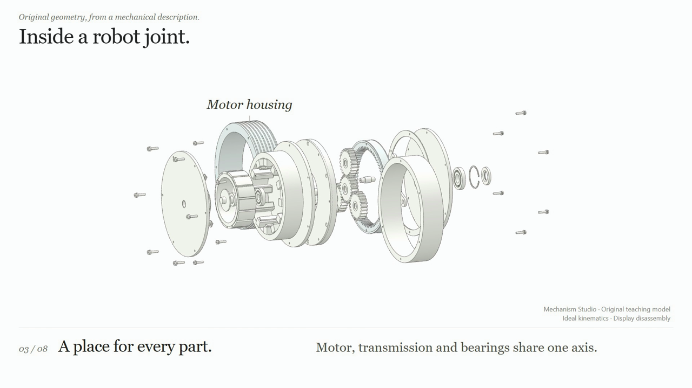
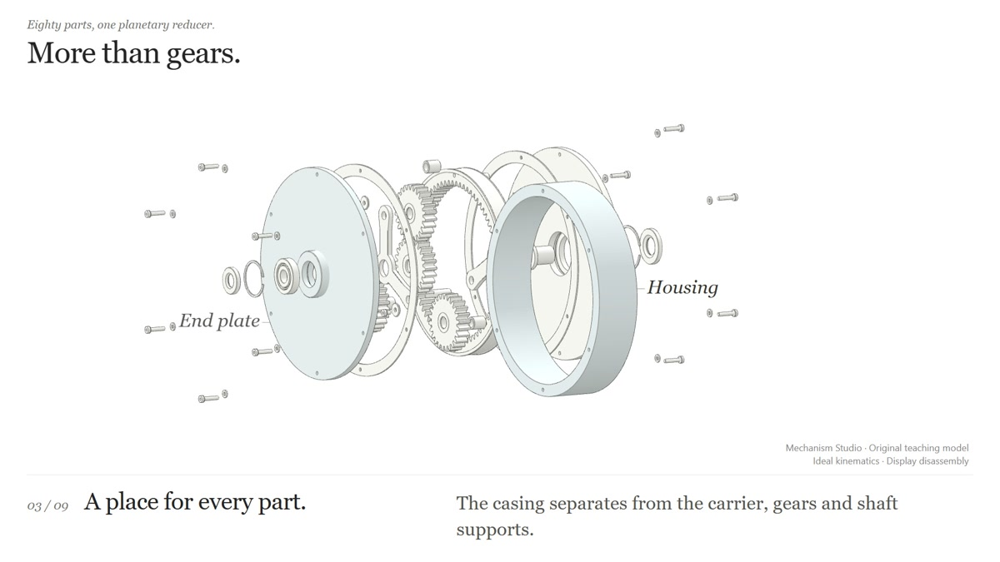

# Mechanism Studio

**Describe a mechanism. Build its parts. Show how it works.**

Mechanism Studio is a project-local AI authoring skill and a working browser toolkit for mechanical explanation. Give an agent a description or reference image: it authors an original parametric teaching assembly, gives each part a stable identity, then coordinates motion, exploded views, cameras, close annotations and synchronized sound. The default presentation is white surfaces with fine dark edges and restrained colour cues. A model download is not a prerequisite; importing an existing CAD assembly remains an optional route.

**Status: public alpha.** The latest tagged release is **v0.4.1-alpha.1**; this README describes the newer `main` branch, including the original robot joint and unified generation/preview/export entry. This working research prototype is ready for experimentation and feedback; its APIs and authoring workflow may change. Examples range from original teaching mechanisms to source-backed robot descriptions and an optional real STEP inspector. Engineering constraints, collision-free disassembly and general image-to-CAD reconstruction remain future work.

**Generate → preview → export:** `npm run studio -- generate robot-joint` rebuilds an original assembly and its score from local code. `preview <id>` starts its local page; `export <id>` starts the calibration-and-export workbench where supported. Run `npm run studio -- list` for the available recipes and adapters. These are named implementations; for a new description, the agent writes the corresponding specification, builder and runtime adapter. [Commands and export limits](tools/studio/README.md).

**Original design: [Inside a robot joint](examples/robot-joint/README.md).** A locally generated 129-part actuator with a motor, planetary reducer, two detailed shaft bearings, output flange, enclosure and repeated fasteners. Its 36-second English white-line loop moves from the whole assembly into motor, gear-pair and bearing close-ups before full reassembly, with original code music. A grouped part chooser links to model clicks. The motor's 12 winding packs and 14 magnets are authored geometry; ideal 4:1 reduction and bearing rolling show mechanical relationships without claiming manufacturing CAD or dynamics validation.



*At 11.8 seconds in the 36-second film. [Watch the published video](https://x.com/tutao0123/status/2113647451538419915) or [generate and run the joint](examples/robot-joint/README.md). Original geometry, presentation and code-generated score: MIT. The MP4 is a generated delivery, not a tracked repository asset.*

**New: [More than gears](examples/planetary-gears/README.md).** An original 80-part planetary reducer with 24 / 24 / 72 teeth, a fixed ring and ideal 4:1 reduction. Its 36-second Atlas loop opens the enclosure, separates the transmission, follows one working gear pair, takes apart a 13-component shaft bearing, then seats its races and demonstrates coupled ball/cage motion before reassembly. The original code-generated music is retained. The model and presentation are reproducible from local source; bearing motion is prescribed ideal rolling, not a contact or load simulation.



*Read the [Alpha release notes](docs/releases/v0.4.1-alpha.1.md) for the tagged release's workflow, requirements and known limits. Newer `main` additions are described here and in the [example guide](examples/README.md).*

**New robot studies:** [Allegro dexterous hand](examples/allegro-hand/README.md)
and [Robotiq 2F-85 gripper](examples/robotiq-gripper/README.md). Each has a
35.6-second English loop: source-based joint motion, link separation, a local
mechanism view and reassembly, with original code-generated music. Their MJCF
link models are separate from fastener-level manufacturing CAD.

<a href="examples/allegro-hand/README.md"></a>
<a href="examples/robotiq-gripper/README.md"></a>

*Allegro model: SimLab / Wonik Robotics; Robotiq model: ROS-Industrial, both via
MuJoCo Menagerie. Source and adapted geometry retain their model-specific
[BSD-2-Clause notices](THIRD_PARTY_NOTICES.md). The [integration report](docs/robot-studies-release.md)
covers their compatibility with the shared study server after the latest upstream sync.*

**Gearbox editions: [A gearbox, revealed](examples/gearbox/README.md).** The original five-speed teaching gearbox below has three editions on one local server: the default 40-second white atlas (`/`), an opt-in blueprint (`/blueprint/`) and an optional 24-second [cinematic edition](examples/gearbox/cinematic/README.md) (`/cinematic/`). [Run it locally](#try-it-locally).


*[A gearbox, revealed](examples/gearbox/README.md): an original five-speed teaching gearbox with 124 parts in 15 nested assemblies, six power paths and a synchronizer close-up. This 17-second excerpt shows the case lifting off, the explosion and the torque path through 1st and 2nd; the full 40-second loop with music runs locally. Exact tooth ratios, slowed for reading; original MIT model and score, not a production design.*


*The same moment in two editions: the default white atlas (top) and an opt-in [blueprint](examples/gearbox/README.md#40-second-editions) (bottom), drawn white-on-blue with centre lines on the shaft axes; the full blueprint page adds a title block and one stamp. Labels carry an index and a spec line computed from the model, and dimensions appear only while their parts are assembled. The style ideas come from the [lemo-opuscar](https://github.com/lemomo-ai/lemo-opuscar) library (MIT) and are implemented independently.*


*[A humanoid, revealed](examples/humanoid/README.md), a 35.56-second expansion/reassembly loop. Unitree G1 model © Unitree Robotics, via MuJoCo Menagerie, [BSD-3-Clause](examples/humanoid/source/unitree_g1/LICENSE). Thirty source bodies and 35 visual occurrences retain their identities; this is link-level presentation, not a detailed actuator teardown. Original score plus five separately credited Kenney CC0 effects.*


*SO-ARM 102 by [Robonine](https://github.com/roboninecom/SO-ARM-102/tree/e871f738c97f43de230cb04d340797da6a68c4b9/simulation/urdf), CC BY 4.0. Mechanism Studio adds rendering, motion presentation, editorial separation, annotations and original code music. [Watch the published 25.7-second cut](https://x.com/tutao0123/status/2111501272419582272).*

## Try it locally

Start with the original robot joint. Generating its geometry and music requires **Node.js 20.10+** and npm; viewing also needs a browser supporting WebGL 2.

```sh
git clone https://github.com/tutao0123/mechanism-studio.git
cd mechanism-studio
npm ci
npm run studio -- generate robot-joint
npm run studio -- preview robot-joint
```

Open **http://127.0.0.1:4198/** and click **Play with music** for the 36-second loop. It includes the 129-part authored assembly, motor, gear-pair and bearing close-ups, and reassembly. Pause and use the grouped part chooser or click the model to inspect occurrences. This first example needs no Python, Blender, CAD download or speech account.

To browse the gallery or optionally inspect the retained STEP sample, use another terminal in the repository:

```sh
npm run studio -- preview step-bearing-assembly  # http://127.0.0.1:4194/
npm run studio -- preview                        # gallery, http://127.0.0.1:4179/
npm run studio -- list                           # all IDs and export support
```

The gallery opens at **http://127.0.0.1:4179/**. Its cards give the dedicated server commands where needed. The original generation recipes use local source code; included viewing assets run without Blender, an MCP connection or speech credentials. Upstream robot meshes and the optional STEP source are not stored in Git: rebuilding/auditing those source-based examples, or running the complete test suite, uses `npm run fetch:sources` to retrieve digest-pinned inputs. That download is separate from original model generation. The unified preview command builds and verifies the selected original score automatically. Study WAVs are not stored in Git; `npm run build:audio` synthesizes every original score if desired. The legacy per-study commands below remain supported.

To generate a checked 36-second MP4, with FFmpeg and FFprobe on PATH:

```sh
npm run studio -- export robot-joint --port 4199
```

Open the printed workbench URL, inspect its two calibration images, then choose **Generate checked MP4**. It composes frames at exact timestamps, encodes the original score and checks both source and decoded frames. Outputs and reports stay under `output/studio/`; it does not publish anything. This is browser-assisted export. `studio list` identifies exportable entries; the STEP inspector remains preview-only. Continuous playback, phone readability and listening still require review.

| Task | Requirements beyond the checkout |
| --- | --- |
| View included examples and synthesize original scores | Node.js 20.10+, npm, WebGL 2 browser |
| Run the full `npm test` suite | Node.js, Git, **Python 3** (`python` on Windows, `python3` elsewhere, or `MECHANISM_PYTHON`) and network access for the first pinned source download |
| Encode video and run optional media integration checks | **FFmpeg and FFprobe** on PATH, plus generated frames/audio |
| Rebuild native CAD or Blender assets | The separately documented project-local OCCT or Blender runtime; not needed for viewing |

For the new dexterous-hand study, generate its local score and start its server:

```sh
node tools/audio/build-study-score.mjs --example examples/allegro-hand
node examples/allegro-hand/serve.mjs
```

Open **http://127.0.0.1:4185/?clean=1**. For the Robotiq gripper, use a separate
terminal:

```sh
node tools/audio/build-study-score.mjs --example examples/robotiq-gripper
node examples/robotiq-gripper/serve.mjs
```

Open **http://127.0.0.1:4186/?clean=1**. Both studies include their source and
display assets; the WAVs are generated locally. Click **Play with music** to
enable sound, or use the silent loop. Their example READMEs include optional
MJCF-to-GLB rebuilding commands and exact source limitations.
Both specialized servers reuse the shared preview runtime while retaining their
own explicit routes. The root gallery links to these server commands; it does
not serve either study under `/examples/`.

For the robot music studies, use a second terminal:

```sh
node EXAMPLE_ROBOT/serve.mjs
```

Open **http://127.0.0.1:4180/kinetic/?clean=1** for the 25.7-second kinetic cut, or **http://127.0.0.1:4180/?clean=1** for the retained 34.3-second assembly study. Click **Play with music** to enable sound. Reduced-motion preferences start the presentation paused.

For the new humanoid, run `node examples/humanoid/serve.mjs` and open
**http://127.0.0.1:4182/?clean=1**. It includes expansion, two close reading views,
reverse-order reassembly, gentle original music and sparse CC0 effects. The
source rest pose is preserved; no gait or dynamic balancing is simulated.

For the gearbox, build its two scores once on a fresh clone:

```sh
node examples/gearbox/audio/build.mjs
node examples/gearbox/cinematic/audio/build.mjs
node examples/gearbox/serve.mjs
```

Open **http://127.0.0.1:4183/?clean=1** for the 40-second atlas study,
**http://127.0.0.1:4183/blueprint/?clean=1** for the blueprint edition or
**http://127.0.0.1:4183/cinematic/** for the 24-second cinematic edition. The
scores are generated locally from deterministic source; WAVs and rendered MP4s
are excluded from Git. See the [gearbox guide](examples/gearbox/README.md) for
rebuild commands, evidence and limits.

For the original planetary set:

```sh
node examples/planetary-gears/audio/build.mjs
node examples/planetary-gears/serve.mjs
```

Open **http://127.0.0.1:4193/?clean=1** for the 36-second loop. The included
model needs no external CAD download; the [planetary guide](examples/planetary-gears/README.md)
also documents geometry rebuilding, component identities and ideal-motion limits.

## Examples

| Example | What to explore | Scope |
| --- | --- | --- |
| [Original robot joint](examples/robot-joint/README.md) | Motor, reducer, bearing and flange structure; 129-part explosion, three local views, grouped part selection and reassembly; 36 seconds | Original local recipe; 44 definitions, root plus five subassemblies; ideal 4:1 gearing/rolling, no electromagnetic or load solver |
| [Planetary reducer](examples/planetary-gears/README.md) | 80-part enclosure/transmission explosion, working gear-pair close-up, 13-part bearing teardown and seated rolling detail, complete reassembly; 36 seconds | Original 24 / 24 / 72 teaching model; ideal 4:1 reduction and shaft-coupled bearing kinematics; plain planet bushings, no contact/load solver |
| [Five-speed gearbox](examples/gearbox/README.md) | Case, three shafts, 13 gears and three synchronizers; drive through 1st–5th with the active power path highlighted and a synchronizer close-up; 40 seconds | Original teaching model, 124 parts / 15 assemblies; exact tooth ratios, no load, friction or clutch simulation |
| [Leader Arm STEP inspector](examples/step-bearing-assembly/README.md), optional import example | Source assembly tree, tree/model linked selection, 43 repeated screws, six bearing stations, hide/isolate/restore | Real AP242 source, Apache-2.0; 22 definitions / 99 part occurrences, exact source identity and placement; no inferred joints or bearing internals |
| [Allegro dexterous hand](examples/allegro-hand/README.md) | Finger curl, thumb opposition, source finger-chain separation and restoration; 35.56 seconds | Sixteen declared hinges; valid neutral pose and source limits, no tendon/contact simulation or invented internal parts |
| [Robotiq 2F-85 gripper](examples/robotiq-gripper/README.md) | Coordinated jaws, local four-bar linkage, exploded links and reassembly; 35.56 seconds | Analytic closure of the pinned source linkage; authored free-space path, no object-contact or force solution |
| [Unitree G1 humanoid](examples/humanoid/README.md) | Full-body expansion, close shoulder/wrist and knee/ankle views, restoration, music and action cues; 35.56 seconds | 30 MJCF body identities, 35 source visual occurrences, 29 retained joint declarations; static source pose, no per-screw internals |
| [SO-ARM 102 kinetic cut](EXAMPLE_ROBOT/kinetic/README.md) | Source-backed jaw and arm movement, cascading explosion, two readable details, musical reassembly; 25.7 seconds | Five revolute and two prismatic URDF joints; eight merged link meshes |
| [SO-ARM 102 assembly study](EXAMPLE_ROBOT/README.md) | Near-part names, restrained colour changes, original music; 34.3 seconds | Link-level visual separation; no per-fastener identity |
| [Five-pin lock](prototype-3d/README.md) | Key comparison, shear line, insertion, turning and explosion | Authored teaching geometry; ideal pin-stack alignment |
| [Inline-four engine](examples/inline-four/README.md) | Crank, rods, pistons, valve timing, intake spray, ignition and exhaust | Prescribed kinematics and explanatory process effects |
| [Two-spool turbofan](examples/turbofan/README.md) | Independent shafts, rotor/stator groups, core/bypass flow and combustion cues | Prescribed spool speeds; no thrust or thermodynamic solution |
| [Small quadruped](examples/quadruped/README.md) | Leg FK/IK, diagonal gait, limits, foot paths and explosion | Kinematics with a fixed body; no balance or contact-force solution |

[Example guide](examples/README.md) includes routes, previews, server commands, assets, source licenses and rebuilding requirements. The [status audit](docs/examples-status.md) explains which directories are historical and which delivery files are intentionally excluded. The retained [English story pages](showcase/README.md) are at **http://127.0.0.1:4179/showcase/**: quadruped Showcase is 33.984 seconds; its 91.944-second Explain edition remains. Engine and turbofan lessons remain full-length. These pages run as silent visual/text previews in a fresh clone; provider-generated narration MP3s are excluded from this public release.

## Use the skill

Open this repository as the working project. The entry point is [.agents/skills/mechanism-studio/SKILL.md](.agents/skills/mechanism-studio/SKILL.md). A compatible agent can discover it locally; otherwise ask the agent to read that file explicitly. No global skill installation is required.

```text
Use $mechanism-studio to design an original small robot joint actuator.
Generate its motor, reducer, bearings, output flange, case and fasteners
locally, with explicit design assumptions and separately selectable parts.
Make a 36-second English showcase with explosion and reassembly,
close part labels, white line art and code-generated music.
Keep all work in this project.
```

There is **one discoverable skill**. Its [original generation stage](.agents/skills/mechanism-studio/references/original-generation.md) prepares actual geometry, a part list and assembly identities before coordinating four specialist authoring modules. They share real part IDs, a geometry revision, units, coordinate frames and one timeline:

| Module | Responsibility | Main output |
| --- | --- | --- |
| [Assembly explosion](.agents/skills/mechanism-studio/references/modules/assembly-explode.md) | Grouping, separation order, offsets, restoration and parent compensation | An explosion plan bound to actual parts and implementation adapters |
| [Camera direction](.agents/skills/mechanism-studio/references/modules/camera-direction.md) | Envelope framing, shot selection, deliberate cuts, settled reading and loop closure | A camera plan compatible with motion, visibility and annotations |
| [Materials and lighting](.agents/skills/mechanism-studio/references/modules/materials-lighting.md) | Neutral line art, readable surfaces, restrained colour cues and owned appearance layers | An appearance plan with reversible source-ID bindings |
| [Mating close-up](.agents/skills/mechanism-studio/references/modules/mating-closeup.md) | Source-bound component relationships, local phase highlights and spin/orbit direction | A close-up plan with evidence, cue meaning and camera/appearance handoffs |

These are documented modules within the main skill, rather than separately installed autonomous skills. The [executable presentation plan](.agents/skills/mechanism-studio/references/executable-presentation.md) now runs a defined subset: display offsets, fixed-envelope orthographic shots, near-part labels and accents/opacity on one clock. Robot joint, planetary reducer, gearbox and Robotiq expose `presentation.mjs` adapters. The broader authoring handoffs remain guidance; mechanics, cinematic paths and specialized effects keep their explicit adapters.

See the **[skill user guide](docs/skill-guide.md)** for invocation, the full workflow and practical prompts, and the **[module catalog](docs/modules.md)** for inputs, outputs, dependencies, invariants and limits. Supporting references cover text/image/CAD intake, engineering evidence, process effects, captions, audio and delivery.

### Three authoring routes

- **Inspect:** source identities, assembly tree, selection and evidence. Static CAD inspection is silent by default.
- **Explain:** a mechanism model, explicit simplifications, controls and a detailed lesson.
- **Showcase:** a short public presentation, normally 30–40 seconds, with independent action timing and readable holds. The 25.7-second robot cut is an explicit shorter edit.

These are workflow choices, not universal URL parameters. Text/image demonstrations default to an original authored design, with dimensions and connections recorded as teaching assumptions. An image supplies visible observations and design cues; it does not establish hidden CAD structure. Use imported source identity when the user supplies CAD or asks to reproduce a particular existing assembly.

For detailed teardown requests, the [assembly-depth contract](.agents/skills/mechanism-studio/references/assembly-depth.md)
checks requested component depth against the actual source. The G1 source can
show body/link structure; it cannot reveal unmodeled screws or actuator internals.
Deeper component examples need their own sufficiently detailed source and clear
provenance rather than invented internals attributed to an existing robot.

## How it is built

```text
.agents/skills/mechanism-studio/  Main skill and specialist authoring references
shared/viewer/                   GLB binding, part selection, cameras, line art and display layers
shared/assets/                   Geometry, identity, units, hierarchy and rest-pose checks
shared/cad/                      Source definitions/occurrences, placements and audit evidence
shared/animation/                Clock-free process display primitives
shared/voice/                    Optional speech API; existing lesson identity and verified playback
shared/appearance/               Deterministic colour cues and independent material ownership
shared/study/                    Presentation plans, example bootstrap, music transport and capture
EXAMPLE_ROBOT/                   Source-based robot studies and kinetic adapter
examples/                       Teaching mechanisms and source-based robot studies
prototype-3d/                    Original 3D lock and compatibility entry points
showcase/                        Retained English visual/narration tour adapters
tools/                          Unified Studio entry, CAD import, video encoding and restricted Blender MCP bridge
docs/                           Architecture, module guide, provenance and roadmap
```

Mechanism adapters own working poses and readouts. The viewer applies observation changes on a separate display layer, preserving source identities and rest transforms. Models, cameras, captions and music use one explicit time arrangement. Same-scene part names accumulate near settled parts, use short leaders and fade out together on a scene change.

Original teaching assets include parameterized Node.js builders for the robot joint, planetary reducer and gearbox, plus Blender Python builders for the earlier mechanisms. GLB display geometry is included. Local `.blend` exports are excluded because they embed machine-specific paths; regenerate them with the builders when needed. Third-party examples retain their source records and per-asset notices. The optional Blender MCP bridge has only four lock-specific operations; it is not a general CAD backend and is not connected automatically. Details: [architecture](docs/architecture.md), [module APIs](docs/modules.md), [CAD tools](tools/cad/README.md).

## Verify and rebuild

The full suite uses Python 3 for the retained MJCF parser tests. Install or select it before running `npm test`; a Node-only setup can still preview all included GLBs and build their scores. The first test run downloads pinned source meshes and verifies their hashes. Optional FFmpeg integration checks skip when FFmpeg/FFprobe are unavailable; native CAD and Blender rebuilds use their own setup instructions.

```sh
npm test
npm run release:check
```

Tests exercise mechanical invariants, source mapping, motion ownership, real GLB data, framing, label layout, audio identity and preview routing. Optional local Blender/MP3 delivery and FFmpeg integration checks explain their skips when the required local material is absent. CI checks a clean checkout rather than relying on a local Blender or CAD installation.

Additional commands:

```sh
# Requires locally regenerated narration and FFmpeg/FFprobe; no service call.
npm run verify:audio

# Download the pinned upstream robot meshes and optional STEP source (npm test does this first).
npm run fetch:sources

# Import and audit a STEP package you prepared in examples/<name>/
# (source/assembly.step and source/provenance.json). Importing requires the
# documented project-local OCCT runtime. For the included real STEP specimen,
# follow examples/step-bearing-assembly/README.md.
npm run import:cad -- --example examples/<name>
npm run audit:cad -- --example examples/<name>

# Verify a delivery record's source/evidence fingerprints without requiring local exports.
npm run check:delivery -- --manifest examples/allegro-hand/delivery.json

# Check a registered executable presentation and save numerical evidence.
node tools/study/check-presentation.mjs --example gearbox --output output/presentation-checks/gearbox.json
node tools/study/check-presentation.mjs --example robotiq-gripper --output output/presentation-checks/robotiq-gripper.json
node tools/study/check-presentation.mjs --example planetary-gears --output output/presentation-checks/planetary-gears.json
node tools/study/check-presentation.mjs --example robot-joint --output output/presentation-checks/robot-joint.json
```

The presentation reports check the supported runtime numerically and leave browser/video review explicitly pending. Start another study from [the reusable example template](templates/study/README.md); a plan still needs actual geometry, identity, bounds and any mechanism adapter.

The [delivery checker](.agents/skills/mechanism-studio/references/delivery-evidence.md) detects changed recorded files and distinguishes missing local exports from missing repository assets. Add `--require-local` to require the authoring machine's local media and raw reports. A fresh clone can verify bundled inputs while reporting ignored local evidence as unavailable. A `delivery-drift.json` beside a record documents reviewed later changes to its inputs, each with its old and new hash and evidence; anything undocumented still fails. File integrity does not establish engineering correctness, confirm a review happened, or prove publication; the record keeps those claims separate.

See [XCAF setup](tools/cad/README-xcaf.md), [video encoding](tools/video/README.md) and [voice generation](shared/voice/README.md). Viewing examples never requires speech keys. New optional narration uses a provider-neutral Node/CLI interface with an explicit speech-capable model, matching voice and trusted endpoint; OpenRouter uses its dedicated speech API. Existing Doubao lessons are retained without compulsory migration. No credentials or generated narration are bundled, and preview/tests do not make paid calls.

The scores use original synthesis code. The humanoid adds five unchanged **Kenney CC0** effects, mixed quietly against specific separation, focus and seating events; previous robot scores retain their original synthesis. [Sound-library research](docs/sound-libraries.md) records included and unbundled options and their different licenses. Music and effects follow the same seekable animation clock. The npm package remains marked private to prevent accidental npm publication; this does not restrict cloning or using the GitHub repository.

## Current limits and next work

The browser renders display meshes. STEP input does not by itself provide a mate solver, exact solid measurement, a parametric feature tree or a collision-free removal path. Flow, flame and spray are explanatory effects. Geometry detail and attractive motion do not certify engineering behaviour.

Next milestones are source-bound B-rep measurement with known-answer fixtures; explicit fixed/revolute/prismatic relationships with limits and failure cases; dependency-aware disassembly and collision checks; then broader documented import coverage. Read the [CAD roadmap](docs/cad-roadmap.md). Progress is recorded as delivered capabilities and reproducible checks rather than an arbitrary completion percentage.

## License, sources and contributions

**Original Mechanism Studio code, skill instructions and documentation are MIT-licensed**; see [LICENSE](LICENSE). Third-party code and model assets retain their own licenses. Allegro and Robotiq model data and derived visuals retain their model-specific BSD-2-Clause notices; Unitree G1 retains BSD-3-Clause and Kenney effects retain CC0. SO-ARM 102 is CC BY 4.0; the Leader Arm STEP specimen and its derived display assets retain Apache-2.0. No GPL model is included. The repository's MIT license does not replace those terms.

Read [licensing and the file-scope map](docs/licensing.md) and [third-party notices](THIRD_PARTY_NOTICES.md) before redistributing example assets or recordings. The project began with workflow ideas adapted from Anatomy; that history and the retained MIT notice are recorded in [origins](docs/origins.md). Upstream model authors are credited separately from Mechanism Studio's implementation.

Bug reports, reproducible source fixtures and focused improvements are welcome. [CONTRIBUTING.md](CONTRIBUTING.md) covers local development, module contracts and asset provenance. Please keep private CAD, credentials, generated recordings, local runtimes and caches out of contributions.
