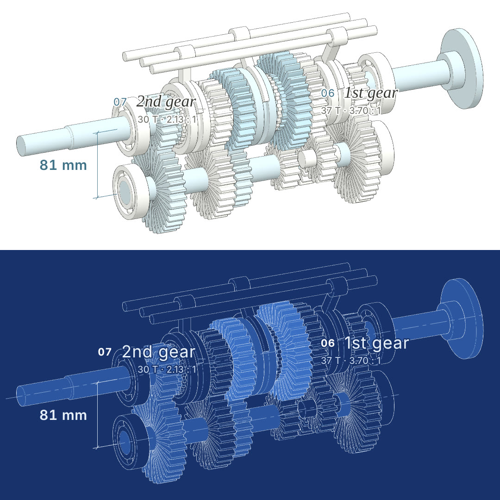
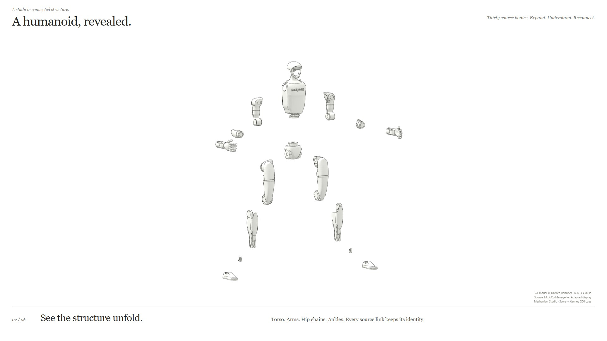
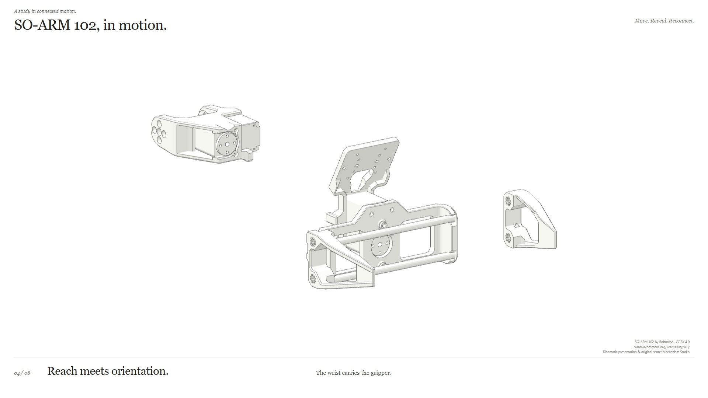

# Mechanism Studio

**Turn mechanical assemblies into inspectable, moving visual stories.**

Mechanism Studio is a project-local AI authoring skill and a working browser toolkit for mechanical explanation. It connects source-aware part identities, independent motion and display layers, exploded views, guided cameras, close annotations and synchronized sound. The default presentation is white surfaces with fine dark edges and restrained colour cues.

**Status: working research prototype, version 0.4.0.** Eleven implemented experiences range from simplified teaching mechanisms to real STEP assemblies and source-backed robot descriptions. Engineering constraints, collision-free disassembly and general image-to-CAD reconstruction remain future work.

**Latest: [WOLF complete teardown, v4](examples/wolf-actuator/tour-v4/README.md).** One 245-leaf assembly moves from the whole actuator into gear-pair, magnet and bearing close-ups, then fully reassembles. Its 85.7-second tour demonstrates the new [Mating Close-up module](.agents/skills/mechanism-studio/references/modules/mating-closeup.md); a portable [delivery record](examples/wolf-actuator/tour-v4/delivery.json) makes the source and output fingerprints inspectable. [Run it locally](#try-it-locally).

[Watch the complete WOLF film on X](https://x.com/tutao0123/status/2111833346468938203). WOLF source and adapted visuals: Anthrobotics and contributors, CC BY-SA 4.0; original score: Mechanism Studio.


*[A gearbox, revealed](examples/gearbox/README.md): an original five-speed teaching gearbox with 124 parts in 15 nested assemblies, six power paths and a synchronizer close-up. This 17-second excerpt shows the case lifting off, the explosion and the torque path through 1st and 2nd; the full 40-second loop with music runs locally. Exact tooth ratios, slowed for reading; original MIT model and score, not a production design.*



*The same moment in two editions: the default white atlas (top) and an opt-in [blueprint](examples/gearbox/README.md#two-editions) (bottom), drawn white-on-blue with centre lines on the shaft axes; the full blueprint page adds a title block and one stamp. Labels carry an index and a spec line computed from the model, and dimensions appear only while their parts are assembled. The style ideas come from the [lemo-opuscar](https://github.com/lemomo-ai/lemo-opuscar) library (MIT) and are implemented independently.*



*[A humanoid, revealed](examples/humanoid/README.md), a 35.56-second expansion/reassembly loop. Unitree G1 model © Unitree Robotics, via MuJoCo Menagerie, [BSD-3-Clause](examples/humanoid/source/unitree_g1/LICENSE). Thirty source bodies and 35 visual occurrences retain their identities; this is link-level presentation, not a detailed actuator teardown. Original score plus five separately credited Kenney CC0 effects.*



*SO-ARM 102 by [Robonine](https://github.com/roboninecom/SO-ARM-102/tree/e871f738c97f43de230cb04d340797da6a68c4b9/simulation/urdf), CC BY 4.0. Mechanism Studio adds rendering, motion presentation, editorial separation, annotations and original code music. [Watch the published 25.7-second cut](https://x.com/tutao0123/status/2111501272419582272).*

## Try it locally

Requires **Node.js 20.10+**, npm and a browser supporting WebGL 2.

```sh
git clone https://github.com/tutao0123/mechanism-studio.git
cd mechanism-studio
npm ci
npm run preview
```

Open **http://127.0.0.1:4179/**. The included viewing assets run locally with no Blender installation, MCP connection or speech credentials. Dependencies are served from the local installation. A first clone includes substantial CAD source files for provenance and reproducibility.

For the robot music studies, use a second terminal:

```sh
node EXAMPLE_ROBOT/serve.mjs
```

Open **http://127.0.0.1:4180/kinetic/?clean=1** for the 25.7-second kinetic cut, or **http://127.0.0.1:4180/?clean=1** for the retained 34.3-second assembly study. Click **Play with music** to enable sound. Reduced-motion preferences start the presentation paused.

For the new humanoid, run `node examples/humanoid/serve.mjs` and open
**http://127.0.0.1:4182/?clean=1**. It includes expansion, two close reading views,
reverse-order reassembly, gentle original music and sparse CC0 effects. The
source rest pose is preserved; no gait or dynamic balancing is simulated.

For the latest WOLF actuator tour, build its shared score once on a fresh clone:

```sh
node examples/wolf-actuator/tour-v2/audio/build.mjs
node examples/wolf-actuator/serve.mjs
```

Open **http://127.0.0.1:4181/tour-v4/** for the 85.714-second whole-to-detail
tour: gear pairing and spin/orbit cues, magnet and bearing close-ups, then full
reassembly. The WOLF server defaults to port 4181; use its printed URL if `PORT`
is overridden. The score is generated locally from deterministic source; the
long WAV and recorded MP4 are excluded from Git. See the [v4 guide](examples/wolf-actuator/tour-v4/README.md)
for the 85.733-second encoded delivery and its recorded verification.

## Examples

| Example | What to explore | Scope |
| --- | --- | --- |
| [Five-speed gearbox](examples/gearbox/README.md) | Case, three shafts, 13 gears and three synchronizers; drive through 1st–5th with the active power path highlighted and a synchronizer close-up; 40 seconds | Original teaching model, 124 parts / 15 assemblies; exact tooth ratios, no load, friction or clutch simulation |
| [Unitree G1 humanoid](examples/humanoid/README.md) | Full-body expansion, close shoulder/wrist and knee/ankle views, restoration, music and action cues; 35.56 seconds | 30 MJCF body identities, 35 source visual occurrences, 29 retained joint declarations; static source pose, no per-screw internals |
| [SO-ARM 102 kinetic cut](EXAMPLE_ROBOT/kinetic/README.md) | Source-backed jaw and arm movement, cascading explosion, two readable details, musical reassembly; 25.7 seconds | Five revolute and two prismatic URDF joints; eight merged link meshes |
| [SO-ARM 102 assembly study](EXAMPLE_ROBOT/README.md) | Near-part names, restrained colour changes, original music; 34.3 seconds | Link-level visual separation; no per-fastener identity |
| [WOLF actuator: complete v4 tour](examples/wolf-actuator/tour-v4/README.md) | Whole 245-leaf actuator → source-bound tooth pairing and spin/orbit cues → magnet and roller close-ups → full reassembly; 85.714 seconds | Ideal source-based gear/bearing kinematics; phase highlights are explanatory, not solved contact. CAD-derived −31.5:1 differs from upstream 34:1; older whole/motor/bearing cuts remain |
| [Galileo 2 source inspector](examples/shaft-bearing/README.md) | Shaft, bearing holder, repeated screws; source tree and mesh selection, hide/isolate/restore | 69 definitions, 146 source usage relations, 147 occurrences including the root |
| [KFL08 bearing assembly](examples/step-assembly/README.md) | Retained STEP, import reports, display fragments and restoration | Historical importer trial: 22 source leaf instances versus 35 display fragments; incomplete identity mapping |
| [Five-pin lock](prototype-3d/README.md) | Key comparison, shear line, insertion, turning and explosion | Authored teaching geometry; ideal pin-stack alignment |
| [Inline-four engine](examples/inline-four/README.md) | Crank, rods, pistons, valve timing, intake spray, ignition and exhaust | Prescribed kinematics and explanatory process effects |
| [Two-spool turbofan](examples/turbofan/README.md) | Independent shafts, rotor/stator groups, core/bypass flow and combustion cues | Prescribed spool speeds; no thrust or thermodynamic solution |
| [Small quadruped](examples/quadruped/README.md) | Leg FK/IK, diagonal gait, limits, foot paths and explosion | Kinematics with a fixed body; no balance or contact-force solution |

[Example guide](examples/README.md) includes routes, previews, server commands, assets, source licenses and rebuilding requirements. The [status audit](docs/examples-status.md) explains which directories are historical and which delivery files are intentionally excluded. The retained [English story pages](showcase/README.md) are at **http://127.0.0.1:4179/showcase/**: quadruped Showcase is 33.984 seconds; its 91.944-second Explain edition remains. Engine and turbofan lessons remain full-length. These pages run as silent visual/text previews in a fresh clone; provider-generated narration MP3s are excluded from this public release.

## Use the skill

Open this repository as the working project. The entry point is [.agents/skills/mechanism-studio/SKILL.md](.agents/skills/mechanism-studio/SKILL.md). A compatible agent can discover it locally; otherwise ask the agent to read that file explicitly. No global skill installation is required.

```text
Use $mechanism-studio to make a 35-second English assembly showcase
from this robot source. Include explosion and reassembly, close part labels,
white line art and code-generated music. Keep all work in this project.
```

There is **one discoverable skill** coordinating four specialist authoring modules. They share real part IDs, a geometry revision, units, coordinate frames and one timeline:

| Module | Responsibility | Main output |
| --- | --- | --- |
| [Assembly explosion](.agents/skills/mechanism-studio/references/modules/assembly-explode.md) | Grouping, separation order, offsets, restoration and parent compensation | An explosion plan bound to actual parts and implementation adapters |
| [Camera direction](.agents/skills/mechanism-studio/references/modules/camera-direction.md) | Envelope framing, shot selection, deliberate cuts, settled reading and loop closure | A camera plan compatible with motion, visibility and annotations |
| [Materials and lighting](.agents/skills/mechanism-studio/references/modules/materials-lighting.md) | Neutral line art, readable surfaces, restrained colour cues and owned appearance layers | An appearance plan with reversible source-ID bindings |
| [Mating close-up](.agents/skills/mechanism-studio/references/modules/mating-closeup.md) | Source-bound component relationships, local phase highlights and spin/orbit direction | A close-up plan with evidence, cue meaning and camera/appearance handoffs |

These are documented modules within the main skill, rather than separately installed autonomous skills. Their plan files are authoring handoffs; current pages execute explicit JavaScript adapters. A generic JSON plan engine is not implemented.

See the **[skill user guide](docs/skill-guide.md)** for invocation, the full workflow and practical prompts, and the **[module catalog](docs/modules.md)** for inputs, outputs, dependencies, invariants and limits. Supporting references cover text/image/CAD intake, engineering evidence, process effects, captions, audio and delivery.

### Three authoring routes

- **Inspect:** source identities, assembly tree, selection and evidence. Static CAD inspection is silent by default.
- **Explain:** a mechanism model, explicit simplifications, controls and a detailed lesson.
- **Showcase:** a short public presentation, normally 30–40 seconds, with independent action timing and readable holds. The 25.7-second robot cut is an explicit shorter edit.

These are workflow choices, not universal URL parameters. Text can define a teaching design; an image can supply visible observations and design cues. Neither establishes hidden CAD structure. Native CAD identities and joints require actual source evidence.

For detailed teardown requests, the [assembly-depth contract](.agents/skills/mechanism-studio/references/assembly-depth.md)
checks requested component depth against the actual source. The G1 source can
show body/link structure; it cannot reveal unmodeled screws or actuator internals.
Deeper component examples need their own sufficiently detailed source and clear
provenance rather than invented internals attributed to an existing robot.

The [WOLF v4 tour](examples/wolf-actuator/tour-v4/README.md) demonstrates deeper
source evidence within one assembly and one music clock. Its paired-tooth
highlights follow retained source geometry, and short arcs distinguish gear
spin from the planet center's orbit. It preserves the existing camera and music
from the earlier full tour. The [motor detail edition](examples/wolf-actuator/detail/README.md)
and other older cuts remain available on the same server. These are editions of
the existing WOLF example, not additional independently modeled assemblies or
representations of Unitree G1's actuator design. They provide no general CAD
mate/contact solver or validated force model.

## How it is built

```text
.agents/skills/mechanism-studio/  Main skill and specialist authoring references
shared/viewer/                   GLB binding, part selection, cameras, line art and display layers
shared/assets/                   Geometry, identity, units, hierarchy and rest-pose checks
shared/cad/                      Source definitions/occurrences, placements and audit evidence
shared/animation/                Clock-free process display primitives
shared/voice/                    Optional speech API; existing lesson identity and verified playback
shared/appearance/               Deterministic colour cues and independent material ownership
shared/study/                    Music transport, annotations, camera direction and capture
EXAMPLE_ROBOT/                   Source-based robot studies and kinetic adapter
examples/                       Teaching mechanisms and real CAD specimens
prototype-3d/                    Original 3D lock and compatibility entry points
showcase/                        Retained English visual/narration tour adapters
tools/                          CAD import, video encoding and restricted Blender MCP bridge
docs/                           Architecture, module guide, provenance and roadmap
```

Mechanism adapters own working poses and readouts. The viewer applies observation changes on a separate display layer, preserving source identities and rest transforms. Models, cameras, captions and music use one explicit time arrangement. Same-scene part names accumulate near settled parts, use short leaders and fade out together on a scene change.

Original teaching assets include Blender Python builders and GLB exports. Local `.blend` exports are excluded because they embed machine-specific paths; regenerate them with the builders when needed. STEP examples retain original source and per-asset notices. The optional Blender MCP bridge has only four lock-specific operations; it is not a general CAD backend and is not connected automatically. Details: [architecture](docs/architecture.md), [module APIs](docs/modules.md), [CAD tools](tools/cad/README.md).

## Verify and rebuild

```sh
npm test
npm run release:check
```

Tests exercise mechanical invariants, source mapping, motion ownership, real GLB data, framing, label layout, audio identity and preview routing. Optional local Blender/MP3 delivery, FFmpeg integration and ignored XCAF-cache checks explain their skips when the required local material is absent. CI checks a clean checkout rather than relying on a local Blender or CAD installation.

Additional commands:

```sh
# Requires locally regenerated narration and FFmpeg/FFprobe; no service call.
npm run verify:audio

# Audit the retained source and derived display assets.
npm run audit:cad -- --example examples/shaft-bearing

# Optional CAD rebuilding requires the documented project-local OCCT runtime.
npm run import:cad -- --example examples/shaft-bearing

# Verify the v4 source/evidence fingerprints without requiring local exports.
npm run check:delivery -- --manifest examples/wolf-actuator/tour-v4/delivery.json
```

The [delivery checker](.agents/skills/mechanism-studio/references/delivery-evidence.md) detects changed recorded files and distinguishes missing local exports from missing repository assets. Add `--require-local` to require the authoring-machine film and raw reports. A fresh clone can verify bundled inputs while reporting ignored local evidence as unavailable. File integrity does not establish engineering correctness, confirm a review happened, or prove publication; the record keeps those claims separate.

See [XCAF setup](tools/cad/README-xcaf.md), [video encoding](tools/video/README.md) and [voice generation](shared/voice/README.md). Viewing examples never requires speech keys. New optional narration uses a provider-neutral Node/CLI interface with an explicit speech-capable model, matching voice and trusted endpoint; OpenRouter uses its dedicated speech API. Existing Doubao lessons are retained without compulsory migration. No credentials or generated narration are bundled, and preview/tests do not make paid calls.

The scores use original synthesis code. The humanoid adds five unchanged **Kenney CC0** effects, mixed quietly against specific separation, focus and seating events; previous robot/WOLF scores retain their original synthesis. [Sound-library research](docs/sound-libraries.md) records included and unbundled options and their different licenses. Music and effects follow the same seekable animation clock. The npm package remains marked private to prevent accidental npm publication; this does not restrict cloning or using the GitHub repository.

## Current limits and next work

The browser renders display meshes. STEP input does not by itself provide a mate solver, exact solid measurement, a parametric feature tree or a collision-free removal path. Flow, flame and spray are explanatory effects. Geometry detail and attractive motion do not certify engineering behaviour.

Next milestones are source-bound B-rep measurement with known-answer fixtures; explicit fixed/revolute/prismatic relationships with limits and failure cases; dependency-aware disassembly and collision checks; then broader documented import coverage. Read the [CAD roadmap](docs/cad-roadmap.md). Progress is recorded as delivered capabilities and reproducible checks rather than an arbitrary completion percentage.

## License, sources and contributions

**Original Mechanism Studio code, skill instructions and documentation are MIT-licensed**; see [LICENSE](LICENSE). Third-party code and model assets retain their own licenses. Unitree G1 model data and derived visuals retain BSD-3-Clause; Kenney effects retain CC0. SO-ARM 102 is CC BY 4.0, KFL08 is CC BY 3.0, WOLF is CC BY-SA 4.0, and Galileo 2 source and geometry derivatives are GPL v3. The repository's MIT license does not replace those terms.

Read [licensing and the file-scope map](docs/licensing.md) and [third-party notices](THIRD_PARTY_NOTICES.md) before redistributing example assets or recordings. The project began with workflow ideas adapted from Anatomy; that history and the retained MIT notice are recorded in [origins](docs/origins.md). Upstream model authors are credited separately from Mechanism Studio's implementation.

Bug reports, reproducible source fixtures and focused improvements are welcome. [CONTRIBUTING.md](CONTRIBUTING.md) covers local development, module contracts and asset provenance. Please keep private CAD, credentials, generated recordings, local runtimes and caches out of contributions.
