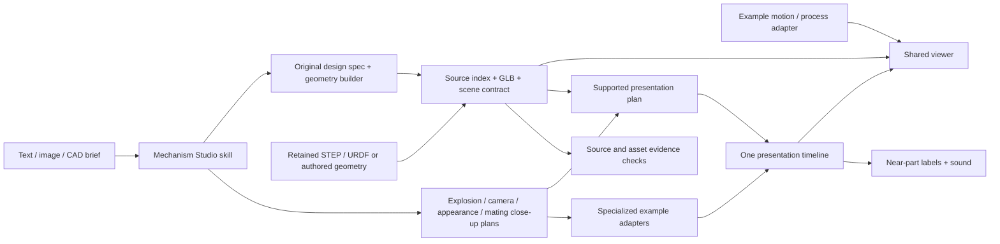

# Architecture

Mechanism Studio has three layers: a project-local authoring skill, reusable
runtime libraries, and example-specific models/adapters. The skill plans work;
JavaScript and optional Python/Blender tools implement it. The shared study runtime
executes the defined `mechanism-presentation-1` subset; broader authoring handoffs
and mechanical models still need example adapters. The skill is not a background service.

[Studio](../tools/studio/README.md) is the unified project-local command layer:
it runs a named original construction recipe, selects a registered preview server,
or opens a supported browser-assisted export adapter. It adds no eighth shared
library or additional discoverable skill.

## Authoring boundary

There is one discoverable [skill entry](../.agents/skills/mechanism-studio/SKILL.md)
and four specialist contracts: explosion, camera direction, materials/lighting
and mating close-ups.
The [skill guide](skill-guide.md) and [module catalog](modules.md) describe each
input/output, dependency, validation step and actual implementation helper.
Inputs first become a brief separating supplied facts, visible observations,
design assumptions and unknowns. A plan is tagged by its actual evidence, not by
the visual polish of the result. Image reconstruction does not create native CAD
identity or reveal hidden mates.

Inspect retains source identity and observation controls. Explain adds a teaching
model and lesson. Showcase composes a short, timed presentation. These choices
select an authoring route, not new runtime URL parameters.

## Runtime libraries

| Library | Owns | Does not own |
| --- | --- | --- |
| [viewer](../shared/viewer/README.md) | GLB loading, semantic IDs, wrappers, picking, line art, cameras, display explosion | Mechanism formulas, engineering source truth |
| [assets](../shared/assets/README.md) | Bounds, units, identity, hierarchy, rest poses and motion ownership validation | CAD solving or manufacturing certification |
| [CAD](../shared/cad/README.md) | Definitions/occurrences, source graph and placement evidence, independent observation state | Recovered mates, exact B-rep measurement |
| [animation](../shared/animation/README.md) | Flow/event display primitives driven by a caller's phase/time | An independent clock or combustion/fluid solver |
| [voice](../shared/voice/README.md) | Lesson identity, explicit Doubao generation, manifests and checked playback | Mechanism decisions or speech-service rights |
| [appearance](../shared/appearance/README.md) | Source-ID-bound colour cues and independent owned material layers | Geometry/source mutation or physical material simulation |
| [study](../shared/study/README.md) | Executable presentation subset, example bootstrap, music transport, stable shot transitions, near-part annotations, capture update path | Mechanical formulas, generic music composition, source joint inference, arbitrary Cinematic profiles |

The retained `showcase/` shell handles the earlier English story adapters. The
music studies use `shared/study/`; the newer robot kinetic adapter supplies source
joints and a separate score. These are maintained implementations, not one
universal presentation configuration. New plan-backed studies use
`compilePresentationPlan(plan, index)` and `startStudyExample(definition)`;
[the plan reference](../.agents/skills/mechanism-studio/references/executable-presentation.md)
separates compiled display channels from example-owned motion and evidence.

`shared/cad/inspector.mjs` connects that CAD observation state to the shared
viewer: source-tree and model selection use one occurrence ID, and repeated
instances retain a shared definition. The example supplies its real manifest,
GLB, provenance, controls and viewing presets.

## Unified generation, preview and export

`npm run studio -- list` reports the explicit registry's 19 preview entries and
their actual generation/export capabilities. `generate <id>` rebuilds the named
`robot-joint`, `planetary-gears` or `gearbox` design from its local specification,
then checks identities, provenance and score bindings. A new mechanism needs an
authored builder and adapter; this command is not a generic prompt-to-CAD service.

`preview <id>` starts the existing allowlisted
server for that page and prepares its registered original score when needed.
It keeps normal default ports, accepts `--port`, binds to `127.0.0.1`, and
reports occupied ports without terminating another process.

`export <id>` currently supports `robot-joint`, `planetary-gears`, `gearbox` and
`gearbox-cinematic`. It prepares a local browser-assisted workbench; a WebGL 2
browser renders deterministic absolute-time frames after the user checks the
calibration views and chooses **Generate**. The local encoder uses FFmpeg and
FFprobe to produce the MP4 and objective reports. This is direct frame
composition rather than screen recording, and still requires the browser and
command to remain open. Other entries, including the STEP inspector, are
explicitly preview-only. No registry entry silently gains an authored film or
remote-publication capability.

## Identity, coordinates and motion

Native source definitions and occurrences stay distinct. Repeated screws share a
definition but retain separate parent/local/world placements and selectable IDs.
Authored teaching models use explicit authored identities. Models never invent a
native source occurrence just to label a rendered helper.

The viewer separates source rest nodes, model-owned working poses and independent
display wrappers. GLB rest transforms are already present and must not be applied
twice. A display explosion compensates for parent displacement instead of adding
the same inherited translation twice. Visibility, cutaway, selection and colour
changes do not rewrite source geometry or the mechanism's working state.

Engineering metadata records actual units and source placement. The XCAF route
normalizes verified metre/millimetre source contexts to millimetres, then converts
to metre-based display coordinates once. Every adapter must state its basis and
units; a visually correct camera cannot establish an engineering transform.

The source-backed SO-ARM rig writes absolute poses to the model layer, keeps rest
nodes unchanged and returns working joints to zero before editorial separation.
Its motion remains kinematic. Engine spray, flame and flow follow model phase and
have no mechanical identity or extra animation clock.

## Presentation and sound

One display clock drives a silent preview; after sound activation native media
time drives model, shot, labels and colour cues. Pause/seek/restart must reproduce
the same state. Fixed, sampled geometry envelopes frame whole assemblies; visible
membership changes between macro and whole views use deliberate cuts. Names wait
for settling, appear near real parts in sequence, persist in the same scene and
fade as a group at the next scene. See the maintained style/pacing references.

Original code-generated music and synthesis source ship in Git. Provider MP3s do
not; the public source contains lessons, timing/manifests and optional generation
code. Existing local MP3 and `.blend` outputs remain untouched but ignored.
See [release packaging](release-audit.md) and [licensing](licensing.md).

## CAD evidence and limits

[The Open-source Leader Arm inspector](../examples/step-bearing-assembly/README.md)
is the real STEP reference, imported from a fixed Apache-2.0 upstream revision.
Its 22 source definitions expand to one root and 99 part occurrences, including
43 occurrences of one screw definition and six each of bearings, bearing
housings and rotors. The actual source tree is flat beneath its root and stays
flat in the inspector. Original STEP bytes are fetched by hash; the display
package, terms and provenance are retained in Git. Its source and retained-asset
tests complement the CAD tools' synthetic failure fixtures.

For supported packages, XCAF retains exact
definition/occurrence mapping for native metre or millimetre input and marks
source-triangulated definitions explicitly; success on one package is not
arbitrary STEP coverage. The root audit CLI cross-checks retained bytes, source
metadata, placements, reports and real GLB geometry without independently
solving joints.

Exact solid measurement, mate solving, collision-free disassembly and parametric
feature editing are not implemented. Read [CAD roadmap](cad-roadmap.md) and
[import tooling](../tools/cad/README.md) for the current supported subset.

## Repository boundary

`npm ci` supplies locked dependencies. Preview servers bind to localhost and
allow explicit viewing assets; credentials, tools, source scripts, caches and
private output are not web routes. The optional Blender MCP bridge keeps four
lock-specific operations and does not execute arbitrary Python or auto-connect.
All project-controlled changes and caches stay inside this repository. These
checks do not constitute an operating-system sandbox or grant external posting
authority.
