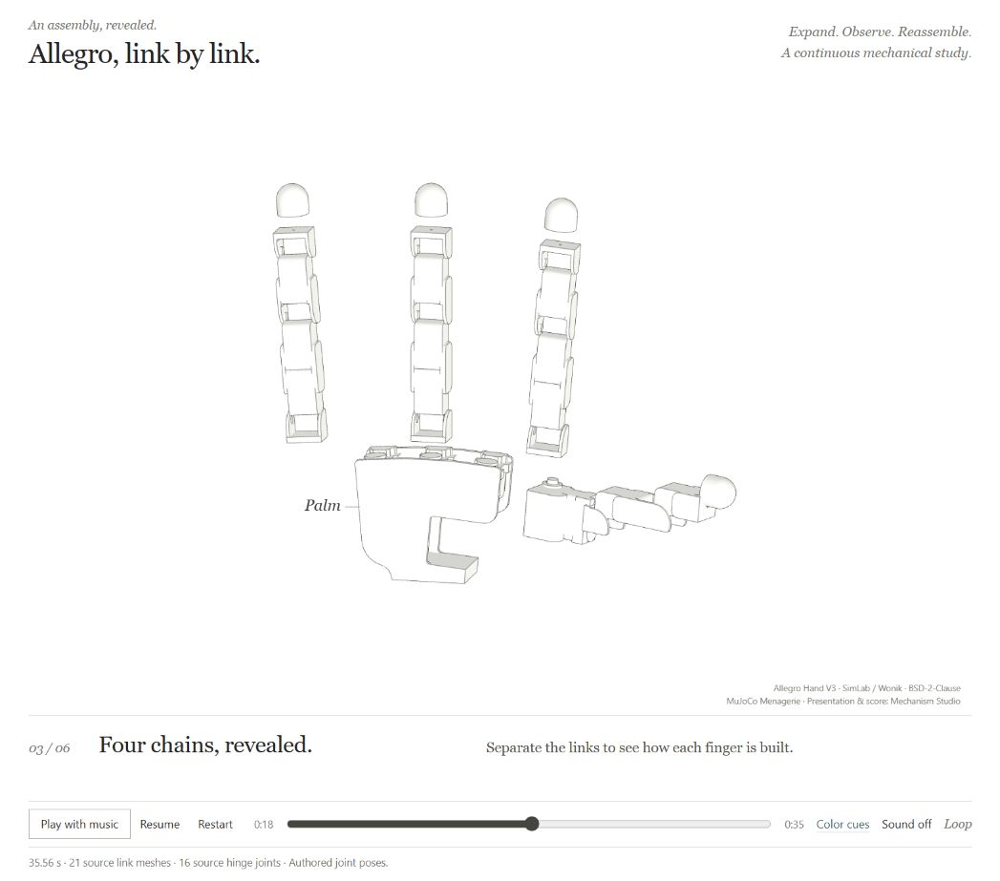
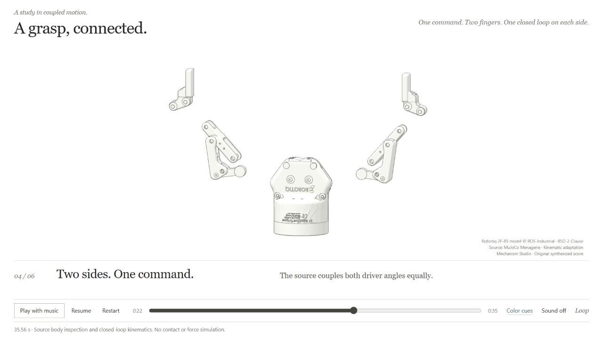
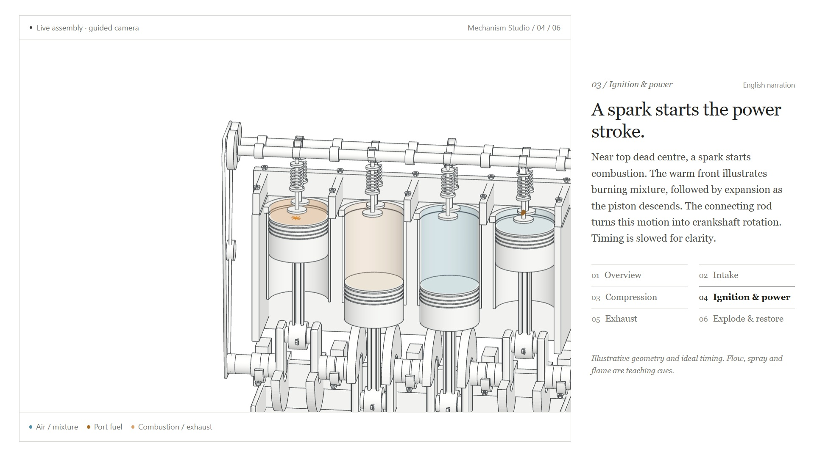
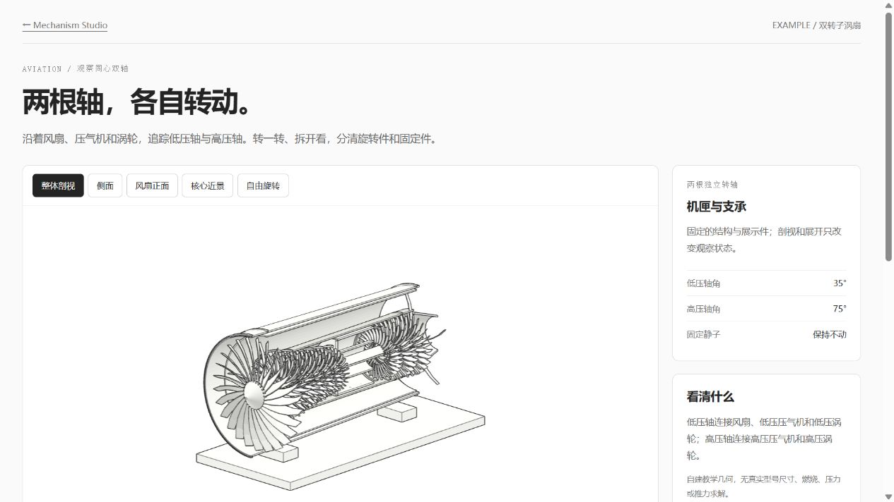
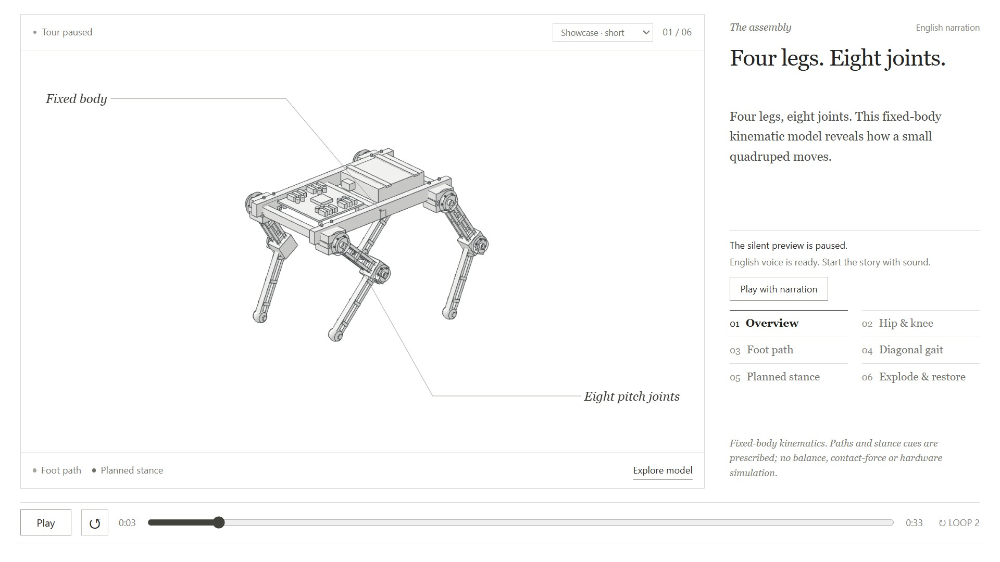

# Example guide

Choose an example by the evidence it can demonstrate: a teaching model, a source-based robot study, or a short presentation. All commands below run from the Mechanism Studio repository root after `npm ci`.

**These are implemented examples, not empty plans.** The maintained lock lives
in `prototype-3d/`, and both SO-ARM robot cuts live in `EXAMPLE_ROBOT/`; neither
is a missing child of this directory. The ten implemented experiences and exact
public/local distinctions are listed in the [status audit](../docs/examples-status.md).
`lock-comparison/` is an explicitly [historical artifact](lock-comparison/README.md).

## Visual entry points

<a href="gearbox/README.md"></a>
<a href="allegro-hand/README.md"></a>
<a href="robotiq-gripper/README.md"></a>
<a href="humanoid/README.md"></a>
<a href="../EXAMPLE_ROBOT/kinetic/README.md"></a>
<a href="inline-four/README.md"></a>
<a href="turbofan/README.md"></a>
<a href="quadruped/README.md"></a>

[Gearbox](gearbox/README.md) ·
[G1 humanoid](humanoid/README.md) ·
[SO-ARM kinetic cut](../EXAMPLE_ROBOT/kinetic/README.md) ·
[Quadruped](quadruped/README.md) ·
[Original lock preview](../prototype-3d/assets/lock-preview.png).
Preview licenses are listed in [media notices](../docs/media/LICENSE.md): G1
retains BSD-3-Clause, Allegro and Robotiq BSD-2-Clause and SO-ARM CC BY 4.0;
original teaching-model previews use the project's MIT terms.
Videos are generated local deliveries, not missing source assets: captured
frames and MP4 exports are intentionally excluded from Git. GitHub does not run
these pages; use a local server below to load models and play music.

## Viewing routes

| Example | Server command | Local route | Included experience |
| --- | --- | --- | --- |
| Five-speed gearbox | `node examples/gearbox/serve.mjs` | `http://127.0.0.1:4183/?clean=1`, blueprint edition `/blueprint/?clean=1` | 40-second original teaching model: case off, explosion to synchronizer keys and bearing balls, power path through 1st–5th, synchronizer close-up, restoration. Spec labels and measured dimensions; the blueprint edition is the same study drawn white-on-blue |
| Allegro dexterous hand | `node examples/allegro-hand/serve.mjs` | `http://127.0.0.1:4185/?clean=1` | 35.56-second articulated finger/ thumb study, source-link expansion, local view and restoration |
| Robotiq 2F-85 gripper | `node examples/robotiq-gripper/serve.mjs` | `http://127.0.0.1:4186/?clean=1` | 35.56-second jaw motion, four-bar closure, link-level explosion and reassembly |
| Unitree G1 humanoid | `node examples/humanoid/serve.mjs` | `http://127.0.0.1:4182/?clean=1` | 35.555556-second body-level explosion/reassembly, close reading views, original score and sparse CC0 effects |
| Five-pin lock | `npm run preview` | `http://127.0.0.1:4179/prototype-3d/?palette=line-light` | Key profiles, insertion and turning, shear-line view, camera presets and display explosion |
| Inline-four | `npm run preview` | `http://127.0.0.1:4179/examples/inline-four/` | Crank-slider motion, valve timing, port spray, ignition and exhaust cues |
| Two-spool turbofan | `npm run preview` | `http://127.0.0.1:4179/examples/turbofan/` | Independent shaft controls, rotor/stator groups and core/bypass flow |
| Small quadruped | `npm run preview` | `http://127.0.0.1:4179/examples/quadruped/` | Leg controls, FK/IK, limits, foot path, diagonal gait and explosion |
| English story pages | `npm run preview` | `http://127.0.0.1:4179/showcase/?story=quadruped&clean=1` | Timed camera, captions and near-part labels; short/full quadruped editions |
| SO-ARM 102 assembly study | `node EXAMPLE_ROBOT/serve.mjs` | `http://127.0.0.1:4180/?clean=1` | 34.285714-second music-driven exploded view and restoration |
| SO-ARM 102 kinetic cut | `node EXAMPLE_ROBOT/serve.mjs` | `http://127.0.0.1:4180/kinetic/?clean=1` | 25.714286-second source-backed joint motion and assembly edit |

The root server handles the studio and original mechanisms; SO-ARM, humanoid, gearbox, Allegro and Robotiq studies use their own explicit read-only route allowlists, sharing one declared study runtime list (`shared/study/preview-server.mjs`) that `tests/preview-pages.test.mjs` checks against every served page. `clean=1` removes surrounding presentation chrome where that page supports it. It does not change source credit or engineering claims. Do not infer other URL options from an authoring mode name.

The Allegro and Robotiq pages require their dedicated servers; their root-gallery
cards expose the launch commands instead of a root `/examples/` route. The
[19 October integration report](../docs/robot-studies-release.md) records their
shared-runtime compatibility checks. Their retained 18 October `validation.md`
and `delivery.json` files describe the earlier local review and its pre-sync
inputs, rather than certifying the current checkout or an exported video.

Generate the gearbox score with `node examples/gearbox/audio/build.mjs`; its
optional cinematic edition at `/cinematic/` uses
`node examples/gearbox/cinematic/audio/build.mjs`.

Each study server prints its local address; a `PORT` override changes the URL.
Generated score WAVs and exported videos are excluded from Git; the synthesis
source, score and viewing adapters are retained. Recording and encoded-media
review remain separate from running the interactive page.

## What a fresh clone includes

Build the soundtracks before music playback: `npm run build:audio` renders every
study score once and checks it against its recorded hash. Original synthesis
code and score metadata are retained; the generated WAVs stay local. To build
only the two robot soundtracks:

```sh
node tools/audio/build-study-score.mjs --example examples/allegro-hand
node tools/audio/build-study-score.mjs --example examples/robotiq-gripper
```

Their visual assets are included, so these viewing commands need no Python.
Optional regeneration from the retained MJCF and pinned STL meshes (`npm run fetch:sources`
downloads the meshes) uses the
[pinned robot importer](../tools/robot/README.md) and Python 3's standard library;
it is separate from launching a page or generating its score.

- GLB display geometry, scene contracts, models, lessons, source/provenance records and implementation adapters.
- Deterministic original-music synthesis source and score metadata for every study. No generated score WAV is in Git; `npm run build:audio` builds them all. The humanoid additionally retains five separately licensed Kenney CC0 effects and their provenance. Click **Play with music** to enable audio; the media clock controls motion, camera, labels and effects together.
- Blender Python builders for the original teaching models. Local `.blend` exports remain on the author's machine because their binary metadata embeds machine-specific paths; rebuild them if needed.
- Third-party model descriptions (MJCF, URDF/Xacro) with their licenses, notices and provenance. The upstream STL meshes are not in Git: `npm run fetch:sources` downloads each from its pinned upstream commit and verifies its SHA-256. These assets are separately licensed from the MIT runtime.

Provider-generated Doubao MP3s are deliberately not in the public source release: the reviewed material did not establish a downstream MIT sublicensing grant. This is not a claim that using Doubao output is prohibited. Silent visuals, captions and the code-music studies remain usable. Lesson scripts/manifests and opt-in generation commands remain for users with their own service account and rights; see [voice setup](../shared/voice/README.md) and [licensing](../docs/licensing.md). Old example notes that describe delivered local narration or Blender files record the development workspace, not a promise that those ignored files are in a fresh clone.

## Teaching models

The [lock](../prototype-3d/README.md), [inline-four](inline-four/README.md), [turbofan](turbofan/README.md) and [quadruped](quadruped/README.md) have authored geometry, explicit dimensions/assumptions and a model-owned working state. Their source code, builders and GLB exports are under the project's MIT license. Blender 4.5 LTS is the documented build environment; it is not needed for viewing.

Read the mechanism's model and README before using its diagrams as engineering evidence. The lock has ideal pin-stack alignment; the engine uses prescribed kinematics and process cues; the turbofan does not solve a thermodynamic cycle; the quadruped has no balance/contact-force solver. Their explosion controls are observation states, separate from working motion.

## Source-based specimens

| Specimen | Source and identity | Asset license and limits |
| --- | --- | --- |
| [Allegro right hand](allegro-hand/README.md) | SimLab / Wonik Robotics model via MuJoCo Menagerie; retained MJCF bodies, sixteen hinges and visual meshes | Model-specific BSD-2-Clause; source-link geometry, no separate tendons, motors, screws or force/contact model |
| [Robotiq 2F-85 v4](robotiq-gripper/README.md) | ROS-Industrial / Robotiq model via MuJoCo Menagerie; retained hinge axes, limits and loop-closure constraints | Model-specific BSD-2-Clause; analytic linkage visualization on the authored free-space branch, not a dynamics or gripping-force model |
| [Unitree G1](humanoid/README.md) | Unitree Robotics / Menagerie MJCF; 30 source bodies, 35 visual occurrences, 29 hinge declarations, 393,270 triangles | BSD-3-Clause at model-directory scope. Static zero-joint source pose; merged link visuals, no individual screws or actuator internals. |
| [SO-ARM 102](../EXAMPLE_ROBOT/README.md) | Robonine simulation URDF and STL meshes; 8 links, 7 joints, 62,064 triangles | CC BY 4.0 under the upstream file-level map. Selected simulation files only; hardware elsewhere has different terms. |

Each source folder retains the pinned upstream revision, source links, hashes and a change notice. Never label all example files MIT. The new whole-repository MIT license applies to original implementation code; [third-party notices](../THIRD_PARTY_NOTICES.md) and [license scope](../docs/licensing.md) identify asset exceptions.

The robot kinetic adapter reads five revolute and two prismatic joints, including the opposed-jaw mimic relation. It resets working poses before display explosion. This is source-backed kinematics, not validated motor control, collision checking or per-screw disassembly. It provides no general CAD mate, contact or dynamics solver.

## Reproduction and checks

```sh
npm test
npm run release:check
npm run check:delivery -- --manifest examples/allegro-hand/delivery.json
```

The Allegro [delivery record](allegro-hand/delivery.json) fingerprints the
recorded inputs, evidence and local outputs. Its checker treats absent ignored
local files as unavailable in a fresh clone; changed files or missing repository
assets fail. Add `--require-local` when checking a complete local delivery. The
[delivery rules](../.agents/skills/mechanism-studio/references/delivery-evidence.md)
separate implementation, verification, export and publication; a matching hash
does not independently validate a mechanical claim or a recorded review.

Use [CAD import setup](../tools/cad/README.md) and [XCAF setup](../tools/cad/README-xcaf.md) before rebuilding engineering derivatives. The root `npm run import:cad -- --example examples/<name>` command requires a supported source package and project-local OCCT backend; it does not generate a new viewer page or recover joints.

`npm run build:audio` runs every music build below and verifies each recorded hash. Individual music rebuild commands include `node EXAMPLE_ROBOT/audio/build.mjs` and `node EXAMPLE_ROBOT/kinetic/audio/build.mjs`. Rebuilding visual assets may require the example's documented Python/Blender environment. Recording is separate from viewing: deterministic capture plus [video encoding](../tools/video/README.md) can produce an MP4, while captured frames, exports and browser review screenshots remain local ignored outputs.

The humanoid rebuilds with `node examples/humanoid/build-humanoid.mjs` (Node and
Python 3 standard library) and `node examples/humanoid/audio/build.mjs` (Node,
retained CC0 samples). Read its [detail limits](humanoid/README.md#source-identity-and-detail-limits)
before treating a source-body explosion as a deeper engineering teardown.

## Adding another example

Follow the [skill guide](../docs/skill-guide.md) and [module catalog](../docs/modules.md). Begin with an input brief, provenance and real part IDs. Reuse the explosion/camera/appearance handoffs and select Mating Close-up for an evidenced component relationship. Bind plans to existing runtime adapters, test seek/reset/loop invariants, and document unsupported claims. A text prompt or image supplies a design brief; it does not prove hidden fasteners, native CAD identity or assembly constraints.
