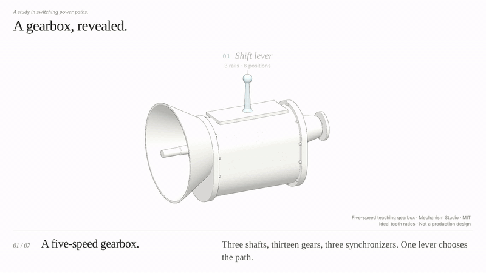

# A gearbox, revealed



*17-second excerpt; run the page below for the full 40-second loop with music.*

A **40-second English looping study** of an original five-speed manual gearbox
with reverse. The case lifts away, the shafts and synchronizers separate, and
then the gearbox drives up through all five forward gears. A pale blue accent
follows the parts actually carrying torque in each gear. A close-up shows a
synchronizer matching speeds before its sleeve slides over the dog teeth. The
case returns and the loop closes on the same view.

This is an **original teaching model**, authored from first principles in this
repository (MIT). It is not a production gearbox, a copy of one, or engineering
CAD. Its value is a structure that is both deeper and more connected than the
other examples:

| | |
| --- | --- |
| Parts / assemblies | **124 parts in 15 assemblies**, three assembly levels deep (gearbox → mainshaft → synchronizer → hub, sleeve, rings, keys) |
| Moving parts | **93**, each with its own working pose: shafts, 13 gears, needle sleeves, races, 37 bearing balls, 3 sleeves, 6 blocker rings, 9 keys, rails, forks, lever |
| Shared definitions | **68** meshes; repeated occurrences (balls, bolts, plates, washers) share one definition |
| Power paths | Six: 1st–5th and reverse; the path changes with the engaged synchronizer |

## View

From the repository root:

```sh
npm ci
node examples/gearbox/audio/build.mjs   # once: renders the gitignored score
node examples/gearbox/serve.mjs
```

Open **http://127.0.0.1:4183/?clean=1** and click **Play with music**. Without the
built score the page plays silently and says so. Pause,
seek, restart, free exploration and **Color cues** work as in the other study
pages. Rotation is shown deliberately slowly so individual teeth stay readable.

## Mechanism

Straight-cut spur gears of module 3 mm. Every countershaft–mainshaft pair has
the same tooth sum (54), so all share one **81 mm** centre distance. The input
gear (20 teeth) drives the countershaft drive gear (34 teeth) in constant mesh.

| Gear | Countershaft → mainshaft teeth | Ratio (input : output) | Path |
| --- | --- | --- | --- |
| 1st | 17 → 37 | **3.70** | input → countershaft → 1st pair → 1–2 sleeve → mainshaft |
| 2nd | 24 → 30 | **2.13** | … 2nd pair → 1–2 sleeve |
| 3rd | 30 → 24 | **1.36** | … 3rd pair → 3–4 sleeve |
| 4th | direct | **1.00** | input gear dogs → 3–4 sleeve → mainshaft; the countershaft turns unloaded |
| 5th | 37 → 17 | **0.78** | … 5th pair → 5–R sleeve (overdrive) |
| Reverse | 16 → idler 18 → 32 | **−3.40** | … through the idler, which reverses rotation |

Mainshaft gears turn freely on needle bearings and are always in mesh. A gear
carries torque only when its synchronizer sleeve is slid over its dog teeth.

- `spec.mjs` holds the authored design: teeth, layout, synchronizers, bearings and
  the reverse idler position, which is solved from its two pitch distances.
- `kinematics.mjs`: every input-train angle is an exact tooth ratio of the input
  angle. Speeds come from an authored drive schedule and are integrated once on a
  fixed 1200 Hz grid, never per frame, so seek, pause and loop are exact.
- During each shift the input speed blends to the new gear's speed (the
  synchronizer's job). A small solved speed adjustment inside that window lines
  the sleeve teeth up with the dog teeth before they engage; the residual is below
  10⁻⁶ rad.
- Gear tooth phases are computed so every mesh interlocks at angle zero and
  stays interlocked at any input angle.
- Speeds are chosen for legibility, and a test enforces it. In steady motion no
  visible tooth or spline passes faster than 5.5 teeth/s, about 0.37 of a tooth
  pitch per frame of a 15 fps GIF. The brief alignment nudge stays under
  7 teeth/s, below the half-pitch limit where teeth appear to turn backwards.

## Rebuild

```sh
node examples/gearbox/build-gearbox.mjs        # GLB, scene contract/index, provenance, report
node examples/gearbox/audio/build.mjs          # original 40 s score (code synthesis, no samples)
node examples/gearbox/planning/build-plans.mjs # module handoff plans
node --test examples/gearbox/tests/*.test.mjs
```

The build is deterministic. `geometryRevision` hashes the authored spec, and
`scene-index.json` records each part's motion role, so the story binds motion
from data rather than names.

## Evidence

`examples/gearbox/tests` checks the following. Mutating the mesh-phase formula,
disabling the dog-alignment solve, or extending a label into a moving shift each
makes a test fail.

- **Mechanism:** shared centre distance; ratios derived from the teeth; reverse
  gears do not clash; the pitch circles of every mesh roll without slip; teeth
  stay interlocked at arbitrary angles.
- **Drive schedule:** engaged output speed equals input speed over the ratio;
  output speed is continuous; dogs stay aligned throughout each engagement; only
  one synchronizer is ever engaged; the loop starts and ends at rest.
- **Asset:** GLB/contract/index agreement and hashes; real exported parents;
  shared definitions for repeated parts; gear tip radii measured from the GLB
  vertices match the spec within 1 µm; outward-facing triangles.
- **Presentation:**
  - every named part stays settled while its name is shown
  - the loop seam is identical (offsets, opacity, camera)
  - the case is hidden inside
  - the accent follows the real power path (4th bypasses the countershaft)
  - the score is the delivered file and its cues sit on real engagements
- **Server:** the preview serves only the page's files; `tests/preview-pages.test.mjs`
  walks the page's full dependency graph.

Browser frames were reviewed at 1920×1080 and in the README GIF. The score is
checked objectively (duration, peak, loop seam, hash); it has **not** been
reviewed by listening.

## Limitations

- An original teaching model with authored dimensions, not a production design.
- Straight-cut spur gears for legibility; production gearboxes typically use
  helical forward gears of differing helix angles.
- Ideal rigid tooth ratios only. No load, friction, backlash, efficiency, contact
  stress or clutch is simulated. Synchronizer speed matching and dog alignment
  are authored on the timeline, not simulated cone friction.
- Ball bearings are idealized pure rolling; needle bearings are plain sleeves.
  Seals, oil, circlips and the shift interlock are omitted. The explosion is an
  editorial separation, not a service procedure.
- Speeds are slowed far below real engine speeds so teeth do not strobe on screen.

## README media

The README GIF is made from one deterministic 1920×1080, 30 fps capture of
`?clean=1&capture=1`. The capture drives `gearboxShowcase.capture.frame(t)` for
every frame and screenshots the page into `examples/gearbox/output/frames/`,
which is gitignored.

- `docs/media/gearbox-readme.gif` is an 800 px, 15 fps excerpt from 3 s to 20 s
  (case off, explosion, reassembly, then 1st and 2nd with the power path).
  GitHub renders it inline.
- A silent 1280 px MP4 of the full loop (about 2 MB) is made by the second
  command, for uploading to sites or GitHub's own video attachments. Like every
  MP4 delivery in this repository, it is kept out of Git by the release policy.

```sh
node tools/video/readme-preview.mjs --frames examples/gearbox/output/frames --fps 30 --out examples/gearbox/output/gearbox-readme --only gif --start 3 --end 20
node tools/video/readme-preview.mjs --frames examples/gearbox/output/frames --fps 30 --out examples/gearbox/output/gearbox-readme-full --only mp4
```

The whole loop as a GIF is about 14 MB because every gear turns, so the README
uses the excerpt. The score WAV is gitignored and rebuilt by `audio/build.mjs`; its
test re-renders it and checks the hash recorded in `music-score.json`. A full 1080p MP4 with music can be made locally with
`tools/video/export.mjs`; it is not committed.

Original code, model, score and media: MIT, © Mechanism Studio contributors.
