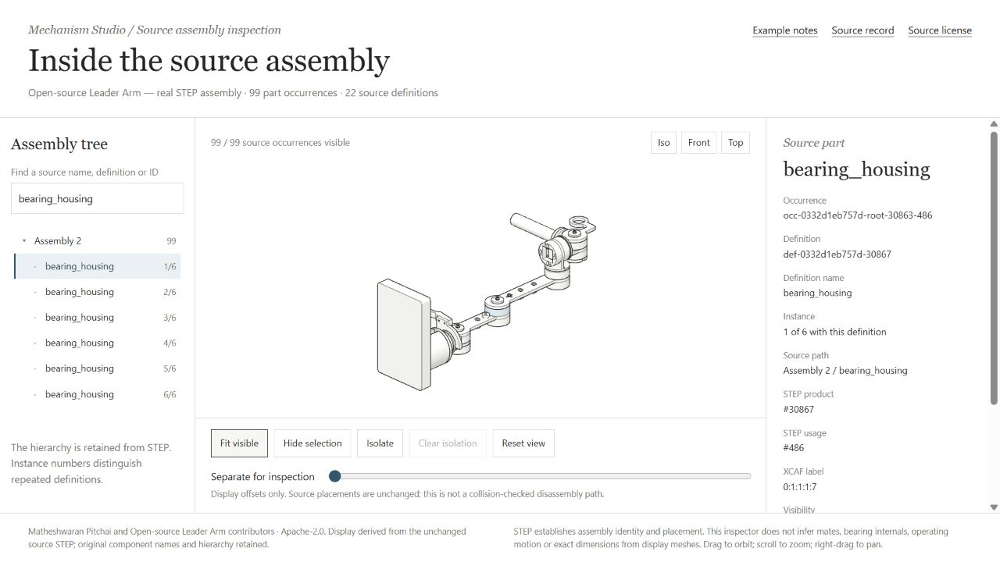

# Open-source Leader Arm — STEP inspection

A real, permissively licensed robot leader-arm assembly for inspecting source
part identity, repeated instances and placed CAD geometry. The upstream arm is
operated by hand; this page is a silent **Inspect** example.

The STEP comes from [Matheshwaranpitchai/open-source-leader-arm](https://github.com/Matheshwaranpitchai/open-source-leader-arm/tree/3cf2ee41e645afe1173dda79914ffe31e174d7a6),
under **Apache-2.0**. Its original Onshape export is unchanged. See
[provenance](source/provenance.json), [license](source/LICENSE.txt) and
[attribution](source/NOTICE.md).

## What is actually in this source

| Retained source fact | Result |
| --- | --- |
| STEP schema | AP242 Edition 2 |
| Native spatial unit | Metres; OCCT imports to mm; glTF displays in metres |
| Product definitions | 22: one assembly and 21 geometry definitions |
| Source occurrences | 100: one root and 99 placed parts |
| Repeated screw | 43 occurrences of one `M3x10 PH Screw` definition |
| Bearing stations | 6 `608 bearing`, 6 `bearing_housing`, 6 `rotor` occurrences |
| Reused geometry definitions | 12 |
| Display mesh | 53,910 unique triangles; 517,242 instanced triangles |
| Missing/recovered faces | 0 / 0 |

The export's actual hierarchy is **`Assembly 2` → 99 direct children**.
The inspector preserves that flat source tree; it does not invent six nested
joint assemblies. `Part 1` is also retained as the source label. Searches and
same-definition navigation are observation tools, not changes to CAD identity.

The official build guide identifies each `rotor` as the rotating member in a
bearing station. This example retains that name rather than inventing a separate
shaft part. Bearings are supplied as single source parts; the STEP does not
provide separately selectable balls, races or cages. The upstream bill of
materials lists 60 screws to purchase, while this exact CAD export contains
43 screw occurrences. Those are different counts and are kept distinct.

## Preview and inspect



Run `npm run studio -- preview step-bearing-assembly` and open
**http://127.0.0.1:4194/**. This example uses its dedicated read-only server.
The committed display assets can be viewed without Python or the original STEP.

Use the source tree or click the model to select the same occurrence. Search for
`M3x10 PH Screw`, then switch between instances: the definition remains shared,
while the occurrence ID and source placement change. Hiding, isolating and
exploding affect display state; reset returns to the retained source placement.

## Restore, rebuild and audit

From the repository root:

```powershell
npm ci
npm run fetch:sources
npm run audit:cad -- --example examples/step-bearing-assembly
```

`fetch:sources` restores `source/assembly.step` from the exact upstream commit,
checks its byte count and SHA-256, and keeps the downloaded file out of Git.
The source is 1,577,215 bytes with SHA-256
`0332d1eb757d3abc3b345d5eed51ba9c53a472ea5c05a08fcfc4bf8cc9f63648`.

Only a fresh CAD rebuild requires the project-local OCCT Python environment:

```powershell
./tools/cad/setup-xcaf.ps1
npm run import:cad -- --example examples/step-bearing-assembly
npm run audit:cad -- --example examples/step-bearing-assembly
node --test examples/step-bearing-assembly/tests/source.test.mjs
```

The import compares fine and coarse tessellation. Real source definitions,
occurrence paths and local/world placements agree across both; the triangle
counts differ. The retained-evidence audit reports `verified` with no missing
or recovered faces. The audit report is written to
`output/cad-check/step-bearing-assembly.json`.

## Scope of the evidence

The audit checks retained product/usage identities, mesh bindings, matrix
consistency, coordinate conversion and face coverage. It does not independently
re-solve the source placement entities, recover CAD mates, measure exact B-rep
dimensions, test contact, or simulate forces. Display explosion is an inspection
aid, not a collision-checked assembly procedure. Browser interaction review is
separate from the automated import audit.
