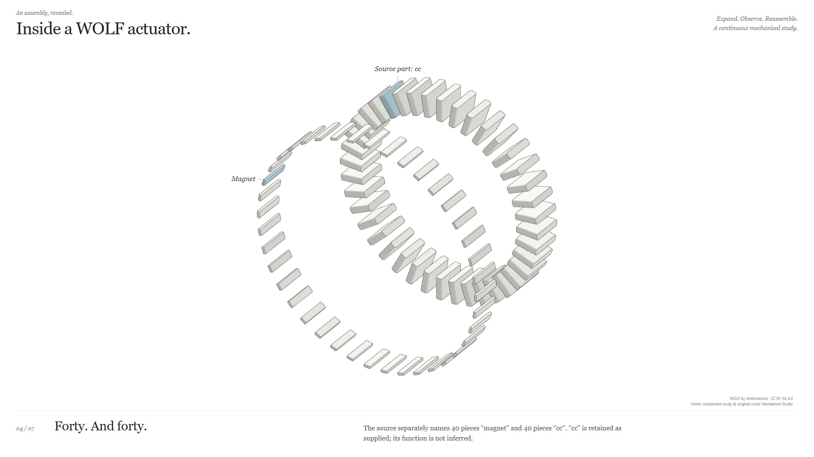

# Inside a WOLF actuator: a real motor component study



*WOLF by Anthrobotics and contributors, CC BY-SA 4.0. Mechanism Studio adds
source-bound separation, white line rendering, camera direction and annotations.*

Open `/detail/?clean=1` on the WOLF preview server. This separate
**34.285714-second** English study goes from the complete WOLF actuator to its
actual `motor-8318 <1>` subassembly, separates its real source components,
examines the repeated pieces and named hardware, restores the motor, then
returns to the complete source assembly.

It uses the existing WOLF STEP-derived GLB and source index. It does **not**
insert this actuator into the G1 humanoid, or claim that it is G1 hardware.
The original WOLF presentation and G1 assets are untouched.

## Source depth and names

The original source component is
`occ-b352183e1bd0-root-953098-1010`, STEP usage `#1010`, definition `#953195`.
It contains **86 independently identified source leaf occurrences**:

| Original source name | Occurrences | Display treatment |
| --- | ---: | --- |
| `magnet` | 40 | Each actual source solid separates radially and axially. |
| `cc` | 40 | Each actual solid separates; the generic source name is retained. |
| `motor-shaft` | 1 | Separate source shaft; no invented screw threads. |
| `motor-hex-nut` | 1 | The one explicitly named source motor fastener. |
| `motor-mount-plate-8318` | 1 | Independent mounting plate. |
| `rotor` | 1 | Original source label, not a dynamically simulated rotor. |
| `stator` | 1 | Holds its source pose throughout the display separation. |
| `rotor-body` | 1 | Original separate body, not a cut from another mesh. |

`cc` is not automatically renamed "coil", "copper winding" or another inferred
function. The source CAD exposes no separate mounting screws, although the
upstream physical BOM lists bolts. No BOM geometry is fabricated for this study.
The full WOLF model also has two independent bearing assemblies, each with an
outer ring and 69 source components, but this focused edition does not pretend
to dismantle their generic `Part N` pieces or reproduce a validated service order.

Source: [Anthrobotics WOLF, pinned revision
776a5654](https://github.com/Anthrobotics/wolf-actuator/tree/776a5654bf2e6fdefbad1ce0f4d88dcaaf1e6dea).
Retained original STEP and display geometry remain **CC BY-SA 4.0**;
see [the license](../source/LICENSE), [source provenance](../source/provenance.json)
and [change/attribution notice](../source/NOTICE.md). Anthrobotics credits Robin
Fröjd's RFX gearbox as inspiration. Mechanism Studio authors the neutral white
line rendering, source-bound display translations, camera, labels and score.

## One timeline, immutable source geometry

All 245 original actuator leaf IDs stay present in the scene and the complete
offset map. Only the 85 moving motor occurrences receive display translations;
the stator and all non-motor source parts remain at rest. Detail visibility
isolates actual owned solids, leaving the original source hierarchy untouched.
Whole-to-component, repeated-piece and hardware edits are deliberate cuts when
the visible source solid set changes. Camera envelopes use actual rest bounds
and all authored extrema, never live expansion feedback.

Four two-beat groups expand at beats **8 / 12 / 16 / 20** and restore in reverse
at **40 / 44 / 48 / 52**. The existing original WOLF score uses the same 112 BPM,
64-beat transport and exactly those motion/seating times. `music-score.json`
rebinds its editorial cue metadata to this edition's actual motor IDs; the WAV
bytes are reused unchanged. Native audio time, silent playback and deterministic
capture all drive the same scene function. The sound effects are authored
textures, not measured hardware sound or collision results.

Names appear sequentially near their source solids after those targets stop,
remain together within each scene, then fade at the scene boundary. The same
restrained colour cue can be turned off. Public text, controls and captions are
English; no narration service is required.

From the Mechanism Studio repository root:

```powershell
node examples/wolf-actuator/detail/build-plans.mjs
node --test examples/wolf-actuator/tests/detail.test.mjs
node examples/wolf-actuator/serve.mjs
```

Open `http://127.0.0.1:4181/detail/?clean=1`, then **Play with music**.
The existing server accepts a `PORT` environment value for another local port.
Public routes are explicit and read-only; the new builder, tests and source CAD
are not exposed by that server. The page exposes `window.wolfMotorDetail` and,
only with `?capture=1`, the shared deterministic capture API.

## Recorded delivery

The local 1920×1080, 30 fps cut is `output/wolf-motor-34s-v1.mp4` after
capture and encoding. Open `/detail/review.html` on this server to review it.
Its 1,029 frames last 34.3 seconds; the 34.285714-second source music receives
14.286 milliseconds of end padding, without changing playback speed.
Recorded MP4s, frames and QA reports are ignored local outputs. A fresh clone
includes the source assets, score and runnable adapters; the review page does
not generate a missing recording.

This is an actual source-component illustration. Explosion is editorial, not
collision-checked disassembly. Source placement does not establish recovered
mates, gear contact, winding function, electromagnetic force, control, thermal
behaviour, tolerance or dynamics. Tests and geometry bounds do not replace a
real browser review.
