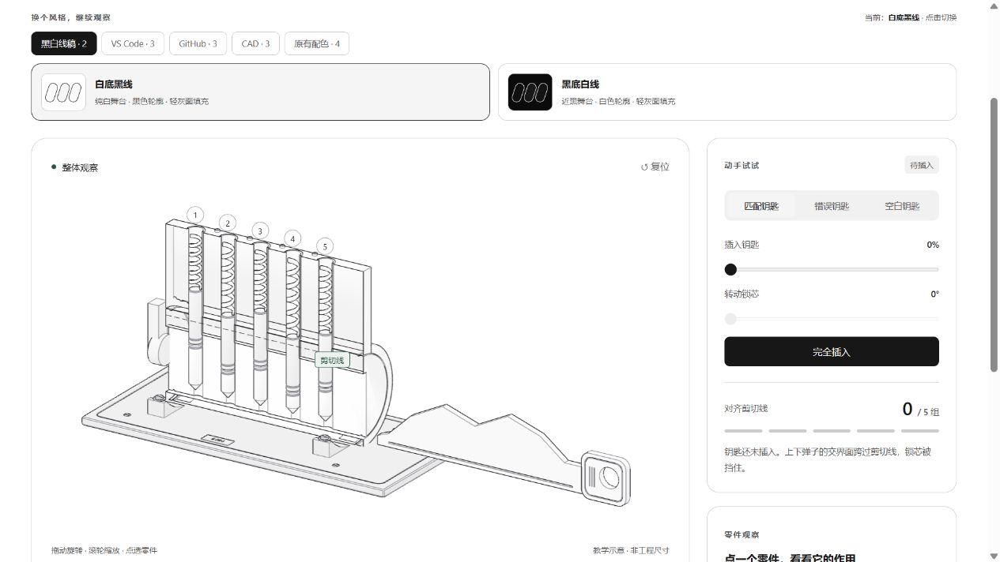

# 锁芯的秘密 · 3D 原型



*Existing interactive preview: original Mechanism Studio teaching geometry and
line rendering (MIT). The screenshot depicts the teaching model, not measured
manufacturer CAD.*

**Public checkout:** the GLB, model, lessons and editable Blender Python builder
are included. Local `.blend` exports and provider-generated Doubao MP3s remain
ignored and are not deleted. Rebuild scenes/audio when needed; see the
[example catalog](../examples/README.md) and [license policy](../docs/licensing.md).
The local-development notes below describe those optional generated files too.

这是新版 Mechanism Studio 流程的第一个实例：Blender 制作可编辑的零件，网页加载 GLB，已有的纯模型决定钥匙齿形、弹子高度、阻挡原因与转动许可。

## 使用

在 Mechanism Studio 项目根目录首次执行 `npm ci`，然后执行 `npm run preview`，打开 <http://127.0.0.1:4179/prototype-3d/>。预览只监听本机。Three.js 通过项目根的 `package-lock.json` 安装至根 `node_modules`，各实例共用；网页运行时不请求外部 CDN，需要本机 HTTP 服务与支持 WebGL 2 的浏览器。父工作区的 4178 总览可作为本机查看入口，新版独立运行不依赖该服务。

- 拖动画面旋转，滚轮缩放；“整体、纵向剖面、轴向、弹子近景、尾部”切换教学视角。
- 匹配、错误、空白钥匙共用原理计算。“完全插入”后可检查各组对齐情况，只有匹配钥匙可以转动。
- 点选零件查看作用；关闭剖面观察外观，或展开零件观察装配关系。展开时机械控件暂停，合拢后继续。
- 点击五步解说，直接停在对应状态。所有按钮和滑杆可用键盘操作。
- “播放本步解说”使用本地生成的豆包音频，可暂停、继续；更换步骤会停止旧音频。
- 顶部外观按黑白线稿、VS Code、GitHub、CAD、原有配色分组，共十五套。没有已保存或 URL 指定的主题时，默认白底黑线。点击系列只切换候选列表，点击方案才改变界面与零件外观；保留机械状态、相机、展开程度和音频播放。选择记在当前浏览器的本机预览站点，也可用 `?palette=主题ID` 指定。

| 系列 | 方案与 URL 主题 ID |
|---|---|
| 黑白线稿 | 白底黑线 `line-light`、黑底白线 `line-dark` |
| VS Code | VS Code 深色 `vscode-dark`、VS Code 浅色 `vscode-light`、Monokai 灵感 `monokai` |
| GitHub | GitHub 浅色 `github-light`、GitHub 深色 `github-dark`、GitHub 柔暗 `github-dimmed` |
| CAD | SolidWorks `solidworks`、Creo `creo`、Fusion 360 `fusion360` |
| 原有配色 | 暖白黄铜 `ivory`、深空蓝 `midnight`、石墨铜 `graphite`、原版蓝金 `original` |

新方案参考 [VS Code 官方 Dark Modern](https://github.com/microsoft/vscode/blob/main/extensions/theme-defaults/themes/dark_modern.json)、[Light Modern](https://github.com/microsoft/vscode/blob/main/extensions/theme-defaults/themes/light_modern.json)、[内置 Monokai](https://github.com/microsoft/vscode/blob/main/extensions/theme-monokai/themes/monokai-color-theme.json) 以及 [GitHub Primer 配色](https://primer.style/product/primitives/color/)。这是用于机械教学的配色适配：保留背景与强调色的风格，并重新设计三维材质、灯光和可读性，不需要安装编辑器主题。

三种 CAD 外观采用不透明实体、深色可见边线与柔和阴影。SolidWorks 沿用用户截图中的冷白到浅灰背景、略带灰紫的实体与橙色选择，显示方式参考其[系统颜色选项](https://help.solidworks.com/2018/english/SolidWorks/sldworks/HIDD_OPTIONS_SYSTEM_COLORS_modeldisplay.htm)。Creo 已按 Parametric 12 官方资料重新核对，采用中灰视口、冷蓝灰实体，带边线着色的边色 `#222226` 与选择色 `#33cc4d` 对应官方[默认系统颜色 RGB 表](https://support.ptc.com/help/creo/creo_pma/r12/usascii/configuration_options/System_Colors.html)。背景与实体灰度参考官方截图作近似；[Default 与 Light (Previous Creo Default)](https://support.ptc.com/help/creo/creo_pma/r12/usascii/configuration_options/About_System_Colors.html)本身就是不同背景方案。

Fusion 360 采用 Autodesk [视图控制教材](https://files.upskill-dev.autodesk.com/public/fusion360-design-for-manufacturing-cert-prep/220225_L2-07_Demonstrate-view-controls.pdf)第 6 页的 Photo Booth 环境与 Shaded with Visible Edges Only 显示：中性灰背景、中性灰实体、深色边线；零件选择参考第 3 页的蓝色面与浅色边界。Fusion 的色值为截图风格适配，没有官方精确 RGB 依据，也不代表所有版本或环境的默认外观。这里选择整个教学零件，未实现 CAD 的单面选择。对齐绿色和受阻玫红继续用于教学提示。核对证据与新截图见 [Creo / Fusion 官方参考复核](validation/cad-reference-check.md)。

尺寸是教学示意。模型省略摩擦、弹簧力、动态碰撞和实际圆柱剪切面的接触公差；弹簧形变为显示拉伸，撤钥匙先原子复位。逻辑测试与导出检查不等于工程或完整碰撞验证。

## 配音

配音文案与豆包适配器在 [voice](voice/README.md)。凭据读取已获得用户授权的外部本地配置，未复制进项目；网页没有 API 密钥。用户指定的语音服务为豆包。

课程、豆包生成协议和本地校验播放器由 [共享配音模块](../shared/voice/README.md) 提供；本例 `voice/synthesize-doubao.mjs` 是保留原命令的兼容入口。切换教学步骤时播放器停止旧音频，播放前核对文案摘要、文件字节数与 SHA-256。

默认命令只校验，不调用服务：

```powershell
node prototype-3d/voice/synthesize-doubao.mjs
```

重新生成配音时指定自己的本地配置路径：

```powershell
node prototype-3d/voice/synthesize-doubao.mjs --generate --config '本地配置文件的绝对路径'
```

## 重建资产

```powershell
node prototype-3d/export-spec.mjs
& '.\prototype-3d\blender\build-lock.ps1'
```

开发机器的 Blender 4.5.14 LTS 便携版、可控缓存和临时目录均在项目 `.tools`，未做系统或用户级安装。运行环境不随源码发布，新使用者需要另行准备项目内环境。[Blender 重建说明](blender/README.md)记录下载校验、坐标和零件接口。受限 MCP 的源码与能力说明见 [tools/blender-mcp](../tools/blender-mcp/README.md)，本机运行时另在 `.tools/blender-mcp`。

`assets/lock.blend` 保存装配展示姿态；`assets/lock.glb` 保存程序控制所需的中性姿态。24 个零件由 `extras.part_id` 标识，`asset-manifest.json` 保存真实导出坐标与尺寸。网页只在适配层把旧模型的示意单位和角度转换为米与弧度。

机械状态与观察状态由 [controller.mjs](controller.mjs)分开。锁芯、钥匙、下弹子和拨片共享绕 X 轴的运动父节点；上弹子和弹簧属于固定锁壳。渲染只在交互、尺寸变化或拖动阻尼尚未收敛时请求帧，离屏或隐藏时停止。

GLB 加载、稳定身份绑定、OrbitControls、机位、可见网格取景、拾取与观察层展开由 [共享查看器](../shared/viewer/README.md) 实际提供；锁芯页面保留钥匙、弹子姿态、配色与教学标签的专项逻辑。

配色数据集中在 [palettes.mjs](palettes.mjs)，每套定义界面、八类零件材质和灯光参数。色标对应当前材质，绿色用于对齐与剪切线；未对齐的弹子单独用玫红标记，避免与铜色弹簧混淆。切换配色只刷新外观，不进入机械控制器。

黑白线稿使用很浅的 Lambert 漫反射填面，帮助分辨曲面与台阶；不产生金属高光。半球环境光保持面接近白色，少量方向光带来淡灰变化。[共享线稿实现](../shared/viewer/line-art.mjs) 将随视角变化的外轮廓和边界画深，明显折角与内部结构线画浅；原 [line-art.mjs](line-art.mjs) 仅转发该实现，保留旧导入兼容性。实体面遮住后方线条，不显示平面上的三角划分线。标准 WebGL 线宽为 1 像素，顶点与颜色缓冲复用；黑白模式关闭舞台渐变、投影和金属反光。对齐提示使用低饱和绿色，受阻弹子的轮廓用少量玫红；点选受阻零件仍保留受阻轮廓。

CAD 模式复用相同的可见轮廓计算，以 Lambert 漫反射表现实体明暗，保留舞台渐变和地面阴影；不使用金属高光或透视后方的线条。点选零件时适量混入各方案的选择色，并强调其轮廓；受阻提示保持优先。三套外观共用原有模型与控制器，视角、剖面、展开和零件选择仍按原方式工作。

精细版本增加圆周和弹簧采样，补充锁壳端部配合、腔口座圈、槽头螺钉、弹子浅环槽、钥匙圆角握柄与侧浅槽、底座浅边槽与铭牌。全部细节归属原有 24 个零件，保留接触刃、弹子长度、剖面、转轴与程序运动接口。细环槽、钥匙浅槽和底座紧固件属于几何展示，不参与开锁判断。具体导出合同与资产规模见 [Blender 说明](blender/README.md)，目录拆分前的截图与功能检查保存在历史 [精修验证](validation/refinement-check.md)。

## 验证

```powershell
node --test model.test.mjs prototype-3d/tests/state.test.mjs prototype-3d/tests/line-art.test.mjs prototype-3d/tests/asset-contract.test.mjs prototype-3d/voice/synthesize-doubao.test.mjs
```

本目录 `validation/` 保留目录拆分前的验证资料；其中浏览器检查使用 Codex 内置浏览器控件和截图，不是网页运行依赖，也不代表迁移后重新执行的结果。需要新验证时在当前根目录运行上面的命令和实际浏览器检查。历史初版 CAD 三款的切换、拆解与警告检查见 [CAD 显示验证](validation/cad-palette-check.md)，Creo / Fusion 配色依据见 [官方参考复核](validation/cad-reference-check.md)；官方参考媒体仅保留在本机，不随源码发布。

来源：[Three.js 官方文档](https://threejs.org/docs/pages/GLTFLoader.html)、[Blender glTF 导出文档](https://docs.blender.org/manual/en/latest/addons/import_export/scene_gltf2.html)。机械原理来源与工作方法见 [原理说明](../docs/anatomy-guide.md)。
